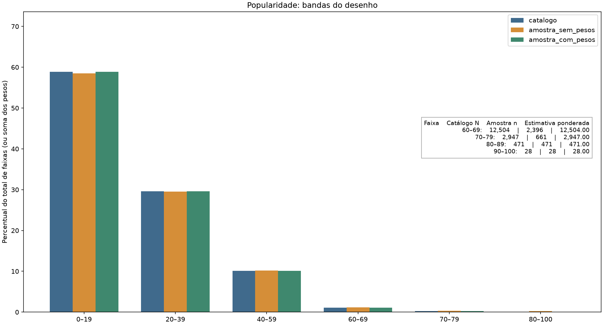
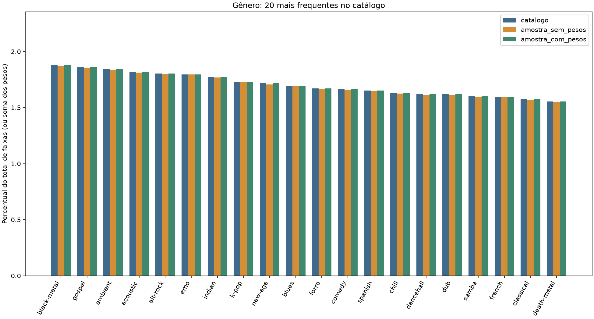
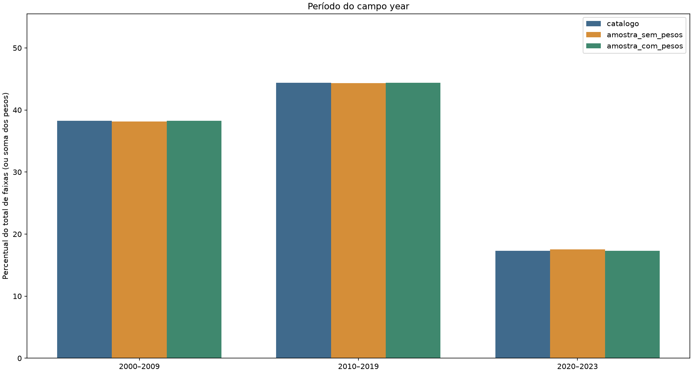

# Relatório da amostra Spotify

Execução: 2026-10-31T19:03:21.722565+00:00. Status final verificável no JSON.

Catálogo: 1,159,764 faixas. Amostra: 200,000 IDs. Inclusão integral ≥80: 499 faixas, já dentro do total.

## Reconciliação antes do sorteio

| metric | observed |
| --- | --- |
| rows | 1159764 |
| distinct_track_ids | 1159764 |
| missing_track_ids | 0 |
| duplicate_id_excess_rows | 0 |
| popularity_ge_80 | 499 |

SHA-256 do CSV conferido contra auditoria: `42fff9e85d1b26c3653b4668959d1be395fab8956848f0478bf28f726b3d5897`. Contagens anuais e por gênero reconciliadas exatamente; nenhuma linha rejeitada/corrigida.

## Complemento de identidade

| metric | catalogo | amostra_observada |
| --- | --- | --- |
| rows | 1159764 | 200000 |
| distinct_track_ids | 1159764 | 200000 |
| distinct_title_strings | 882360 | 174569 |
| distinct_artist_credit_strings | 64157 | 39870 |
| distinct_complete_artist_title_pairs | 1159748 | 199998 |
| missing_track_ids | 0 | 0 |
| missing_titles | 1 | 0 |
| missing_artist_credits | 15 | 2 |
| incomplete_artist_title_pairs | 16 | 2 |

Strings: trim de espaços U+0020; tokens de ausência exatos '', NA, N/A, null, None. Sem normalização de caixa, acentos, aliases ou colaborações. Títulos distintos não são composições únicas; créditos textuais não identificam pessoas. Originais preservados no Parquet.

## Alocação e verificações

| strata | certainty_strata | reserved_units | population | sample |
| --- | --- | --- | --- | --- |
| 981 | 62 | 2422 | 1159764 | 200000 |

| check | value |
| --- | --- |
| exact_total | True |
| unique_ids | True |
| all_ids_in_catalog | True |
| all_ge80_included | True |
| allocation_matches | True |
| probabilities_valid | True |
| weights_finite_positive | True |
| weight_sum_matches_population | True |
| same_seed_reproduced | True |
| original_columns_preserved | True |
| weighted_design_margins_match | True |
| parquet_roundtrip_equal | True |
| input_hash_unchanged | True |

## Comparação descritiva

Resumo numérico: mesmos quantis por inversa da CDF e desvio-padrão descritivo com divisor soma(w) nos três escopos; não é erro-padrão do desenho. A auditoria anterior usou quantis interpolados/desvio n−1, portanto pequenas diferenças de convenção são esperadas.

### popularity: todos os valores finitos

| scope | n_observed | weight_observed | mean | std_population | q01 | q05 | q25 | q50 | q75 | q95 | q99 |
| --- | --- | --- | --- | --- | --- | --- | --- | --- | --- | --- | --- |
| catalogo | 1159764 | 1159764.0000 | 18.3831 | 15.8855 | 0.0000 | 0.0000 | 5.0000 | 15.0000 | 29.0000 | 49.0000 | 62.0000 |
| amostra_sem_pesos | 200000 | 200000.0000 | 18.6752 | 16.2810 | 0.0000 | 0.0000 | 5.0000 | 15.0000 | 29.0000 | 49.0000 | 64.0000 |
| amostra_com_pesos | 200000 | 1159764.0000 | 18.3899 | 15.8805 | 0.0000 | 0.0000 | 5.0000 | 15.0000 | 29.0000 | 49.0000 | 62.0000 |

### danceability: todos os valores finitos

| scope | n_observed | weight_observed | mean | std_population | q01 | q05 | q25 | q50 | q75 | q95 | q99 |
| --- | --- | --- | --- | --- | --- | --- | --- | --- | --- | --- | --- |
| catalogo | 1159764 | 1159764.0000 | 0.5374 | 0.1845 | 0.1090 | 0.2040 | 0.4130 | 0.5500 | 0.6770 | 0.8110 | 0.8880 |
| amostra_sem_pesos | 200000 | 200000.0000 | 0.5379 | 0.1842 | 0.1090 | 0.2050 | 0.4130 | 0.5510 | 0.6770 | 0.8120 | 0.8880 |
| amostra_com_pesos | 200000 | 1159764.0000 | 0.5375 | 0.1843 | 0.1090 | 0.2050 | 0.4130 | 0.5500 | 0.6770 | 0.8110 | 0.8880 |

### energy: todos os valores finitos

| scope | n_observed | weight_observed | mean | std_population | q01 | q05 | q25 | q50 | q75 | q95 | q99 |
| --- | --- | --- | --- | --- | --- | --- | --- | --- | --- | --- | --- |
| catalogo | 1159764 | 1159764.0000 | 0.6397 | 0.2705 | 0.0180 | 0.1100 | 0.4540 | 0.6940 | 0.8730 | 0.9760 | 0.9940 |
| amostra_sem_pesos | 200000 | 200000.0000 | 0.6401 | 0.2701 | 0.0185 | 0.1120 | 0.4540 | 0.6940 | 0.8730 | 0.9760 | 0.9940 |
| amostra_com_pesos | 200000 | 1159764.0000 | 0.6401 | 0.2704 | 0.0185 | 0.1110 | 0.4540 | 0.6940 | 0.8730 | 0.9760 | 0.9940 |

### key: todos os valores finitos

| scope | n_observed | weight_observed | mean | std_population | q01 | q05 | q25 | q50 | q75 | q95 | q99 |
| --- | --- | --- | --- | --- | --- | --- | --- | --- | --- | --- | --- |
| catalogo | 1159764 | 1159764.0000 | 5.2878 | 3.5552 | 0.0000 | 0.0000 | 2.0000 | 5.0000 | 8.0000 | 11.0000 | 11.0000 |
| amostra_sem_pesos | 200000 | 200000.0000 | 5.2904 | 3.5565 | 0.0000 | 0.0000 | 2.0000 | 5.0000 | 8.0000 | 11.0000 | 11.0000 |
| amostra_com_pesos | 200000 | 1159764.0000 | 5.2903 | 3.5562 | 0.0000 | 0.0000 | 2.0000 | 5.0000 | 8.0000 | 11.0000 | 11.0000 |

### loudness: todos os valores finitos

| scope | n_observed | weight_observed | mean | std_population | q01 | q05 | q25 | q50 | q75 | q95 | q99 |
| --- | --- | --- | --- | --- | --- | --- | --- | --- | --- | --- | --- |
| catalogo | 1159764 | 1159764.0000 | -8.9814 | 5.6822 | -29.9280 | -20.8970 | -10.8290 | -7.4500 | -5.2760 | -3.1470 | -1.7980 |
| amostra_sem_pesos | 200000 | 200000.0000 | -8.9613 | 5.6784 | -29.8880 | -20.8540 | -10.8210 | -7.4210 | -5.2640 | -3.1390 | -1.7890 |
| amostra_com_pesos | 200000 | 1159764.0000 | -8.9727 | 5.6835 | -29.8910 | -20.8780 | -10.8390 | -7.4300 | -5.2690 | -3.1410 | -1.7930 |

### mode: todos os valores finitos

| scope | n_observed | weight_observed | mean | std_population | q01 | q05 | q25 | q50 | q75 | q95 | q99 |
| --- | --- | --- | --- | --- | --- | --- | --- | --- | --- | --- | --- |
| catalogo | 1159764 | 1159764.0000 | 0.6347 | 0.4815 | 0.0000 | 0.0000 | 0.0000 | 1.0000 | 1.0000 | 1.0000 | 1.0000 |
| amostra_sem_pesos | 200000 | 200000.0000 | 0.6344 | 0.4816 | 0.0000 | 0.0000 | 0.0000 | 1.0000 | 1.0000 | 1.0000 | 1.0000 |
| amostra_com_pesos | 200000 | 1159764.0000 | 0.6347 | 0.4815 | 0.0000 | 0.0000 | 0.0000 | 1.0000 | 1.0000 | 1.0000 | 1.0000 |

### speechiness: todos os valores finitos

| scope | n_observed | weight_observed | mean | std_population | q01 | q05 | q25 | q50 | q75 | q95 | q99 |
| --- | --- | --- | --- | --- | --- | --- | --- | --- | --- | --- | --- |
| catalogo | 1159764 | 1159764.0000 | 0.0928 | 0.1268 | 0.0257 | 0.0287 | 0.0371 | 0.0507 | 0.0890 | 0.2980 | 0.9050 |
| amostra_sem_pesos | 200000 | 200000.0000 | 0.0928 | 0.1266 | 0.0257 | 0.0287 | 0.0372 | 0.0507 | 0.0889 | 0.2970 | 0.9050 |
| amostra_com_pesos | 200000 | 1159764.0000 | 0.0929 | 0.1269 | 0.0257 | 0.0287 | 0.0372 | 0.0507 | 0.0889 | 0.2970 | 0.9060 |

### acousticness: todos os valores finitos

| scope | n_observed | weight_observed | mean | std_population | q01 | q05 | q25 | q50 | q75 | q95 | q99 |
| --- | --- | --- | --- | --- | --- | --- | --- | --- | --- | --- | --- |
| catalogo | 1159764 | 1159764.0000 | 0.3215 | 0.3550 | 0.0000 | 0.0000 | 0.0064 | 0.1470 | 0.6400 | 0.9760 | 0.9940 |
| amostra_sem_pesos | 200000 | 200000.0000 | 0.3204 | 0.3546 | 0.0000 | 0.0000 | 0.0063 | 0.1450 | 0.6370 | 0.9760 | 0.9940 |
| amostra_com_pesos | 200000 | 1159764.0000 | 0.3207 | 0.3549 | 0.0000 | 0.0000 | 0.0063 | 0.1450 | 0.6390 | 0.9760 | 0.9940 |

### instrumentalness: todos os valores finitos

| scope | n_observed | weight_observed | mean | std_population | q01 | q05 | q25 | q50 | q75 | q95 | q99 |
| --- | --- | --- | --- | --- | --- | --- | --- | --- | --- | --- | --- |
| catalogo | 1159764 | 1159764.0000 | 0.2523 | 0.3651 | 0.0000 | 0.0000 | 0.0000 | 0.0018 | 0.6140 | 0.9230 | 0.9610 |
| amostra_sem_pesos | 200000 | 200000.0000 | 0.2508 | 0.3644 | 0.0000 | 0.0000 | 0.0000 | 0.0017 | 0.6070 | 0.9220 | 0.9600 |
| amostra_com_pesos | 200000 | 1159764.0000 | 0.2518 | 0.3648 | 0.0000 | 0.0000 | 0.0000 | 0.0018 | 0.6120 | 0.9220 | 0.9600 |

### liveness: todos os valores finitos

| scope | n_observed | weight_observed | mean | std_population | q01 | q05 | q25 | q50 | q75 | q95 | q99 |
| --- | --- | --- | --- | --- | --- | --- | --- | --- | --- | --- | --- |
| catalogo | 1159764 | 1159764.0000 | 0.2230 | 0.2011 | 0.0385 | 0.0604 | 0.0979 | 0.1340 | 0.2920 | 0.7080 | 0.9530 |
| amostra_sem_pesos | 200000 | 200000.0000 | 0.2229 | 0.2009 | 0.0385 | 0.0603 | 0.0978 | 0.1340 | 0.2920 | 0.7080 | 0.9520 |
| amostra_com_pesos | 200000 | 1159764.0000 | 0.2231 | 0.2011 | 0.0385 | 0.0603 | 0.0978 | 0.1340 | 0.2920 | 0.7090 | 0.9520 |

### valence: todos os valores finitos

| scope | n_observed | weight_observed | mean | std_population | q01 | q05 | q25 | q50 | q75 | q95 | q99 |
| --- | --- | --- | --- | --- | --- | --- | --- | --- | --- | --- | --- |
| catalogo | 1159764 | 1159764.0000 | 0.4556 | 0.2685 | 0.0328 | 0.0509 | 0.2260 | 0.4380 | 0.6740 | 0.9100 | 0.9650 |
| amostra_sem_pesos | 200000 | 200000.0000 | 0.4560 | 0.2679 | 0.0328 | 0.0511 | 0.2280 | 0.4390 | 0.6740 | 0.9100 | 0.9640 |
| amostra_com_pesos | 200000 | 1159764.0000 | 0.4558 | 0.2680 | 0.0328 | 0.0509 | 0.2280 | 0.4380 | 0.6740 | 0.9100 | 0.9640 |

### tempo: todos os valores finitos

| scope | n_observed | weight_observed | mean | std_population | q01 | q05 | q25 | q50 | q75 | q95 | q99 |
| --- | --- | --- | --- | --- | --- | --- | --- | --- | --- | --- | --- |
| catalogo | 1159764 | 1159764.0000 | 121.3771 | 29.7797 | 64.6760 | 76.4940 | 98.7970 | 121.9310 | 139.9030 | 174.8840 | 193.5190 |
| amostra_sem_pesos | 200000 | 200000.0000 | 121.3932 | 29.7283 | 64.5430 | 76.5280 | 98.9000 | 121.9660 | 139.8820 | 174.8940 | 193.8550 |
| amostra_com_pesos | 200000 | 1159764.0000 | 121.3875 | 29.7354 | 64.5330 | 76.5230 | 98.8850 | 121.9630 | 139.8790 | 174.9080 | 193.8710 |

### duration_ms: todos os valores finitos

| scope | n_observed | weight_observed | mean | std_population | q01 | q05 | q25 | q50 | q75 | q95 | q99 |
| --- | --- | --- | --- | --- | --- | --- | --- | --- | --- | --- | --- |
| catalogo | 1159764 | 1159764.0000 | 249561.7812 | 149426.1001 | 57307.0000 | 109293.0000 | 181091.0000 | 225744.0000 | 286913.0000 | 448000.0000 | 654280.0000 |
| amostra_sem_pesos | 200000 | 200000.0000 | 249796.3655 | 152938.0718 | 56960.0000 | 109293.0000 | 181030.0000 | 225800.0000 | 286680.0000 | 448253.0000 | 656813.0000 |
| amostra_com_pesos | 200000 | 1159764.0000 | 250012.2609 | 153336.9931 | 56867.0000 | 109127.0000 | 181081.0000 | 225933.0000 | 286960.0000 | 448770.0000 | 659613.0000 |

### time_signature: todos os valores finitos

| scope | n_observed | weight_observed | mean | std_population | q01 | q05 | q25 | q50 | q75 | q95 | q99 |
| --- | --- | --- | --- | --- | --- | --- | --- | --- | --- | --- | --- |
| catalogo | 1159764 | 1159764.0000 | 3.8859 | 0.4677 | 1.0000 | 3.0000 | 4.0000 | 4.0000 | 4.0000 | 4.0000 | 5.0000 |
| amostra_sem_pesos | 200000 | 200000.0000 | 3.8861 | 0.4658 | 1.0000 | 3.0000 | 4.0000 | 4.0000 | 4.0000 | 4.0000 | 5.0000 |
| amostra_com_pesos | 200000 | 1159764.0000 | 3.8859 | 0.4662 | 1.0000 | 3.0000 | 4.0000 | 4.0000 | 4.0000 | 4.0000 | 5.0000 |

## Qualidade e domínios locais

| scope | variable | category | value | denominator |
| --- | --- | --- | --- | --- |
| catalogo | popularity | missing | 0.0000 | 1159764.0000 |
| catalogo | popularity | invalid_parse_or_nonfinite | 0.0000 | 1159764.0000 |
| catalogo | popularity | out_of_local_domain | 0.0000 | 1159764.0000 |
| catalogo | danceability | missing | 0.0000 | 1159764.0000 |
| catalogo | danceability | invalid_parse_or_nonfinite | 0.0000 | 1159764.0000 |
| catalogo | danceability | out_of_local_domain | 0.0000 | 1159764.0000 |
| catalogo | energy | missing | 0.0000 | 1159764.0000 |
| catalogo | energy | invalid_parse_or_nonfinite | 0.0000 | 1159764.0000 |
| catalogo | energy | out_of_local_domain | 0.0000 | 1159764.0000 |
| catalogo | key | missing | 0.0000 | 1159764.0000 |
| catalogo | key | invalid_parse_or_nonfinite | 0.0000 | 1159764.0000 |
| catalogo | key | out_of_local_domain | 0.0000 | 1159764.0000 |
| catalogo | loudness | missing | 0.0000 | 1159764.0000 |
| catalogo | loudness | invalid_parse_or_nonfinite | 0.0000 | 1159764.0000 |
| catalogo | loudness | out_of_local_domain | 0.0000 | 1159764.0000 |
| catalogo | mode | missing | 0.0000 | 1159764.0000 |
| catalogo | mode | invalid_parse_or_nonfinite | 0.0000 | 1159764.0000 |
| catalogo | mode | out_of_local_domain | 0.0000 | 1159764.0000 |
| catalogo | speechiness | missing | 0.0000 | 1159764.0000 |
| catalogo | speechiness | invalid_parse_or_nonfinite | 0.0000 | 1159764.0000 |
| catalogo | speechiness | out_of_local_domain | 0.0000 | 1159764.0000 |
| catalogo | acousticness | missing | 0.0000 | 1159764.0000 |
| catalogo | acousticness | invalid_parse_or_nonfinite | 0.0000 | 1159764.0000 |
| catalogo | acousticness | out_of_local_domain | 0.0000 | 1159764.0000 |
| catalogo | instrumentalness | missing | 0.0000 | 1159764.0000 |
| catalogo | instrumentalness | invalid_parse_or_nonfinite | 0.0000 | 1159764.0000 |
| catalogo | instrumentalness | out_of_local_domain | 0.0000 | 1159764.0000 |
| catalogo | liveness | missing | 0.0000 | 1159764.0000 |
| catalogo | liveness | invalid_parse_or_nonfinite | 0.0000 | 1159764.0000 |
| catalogo | liveness | out_of_local_domain | 0.0000 | 1159764.0000 |
| catalogo | valence | missing | 0.0000 | 1159764.0000 |
| catalogo | valence | invalid_parse_or_nonfinite | 0.0000 | 1159764.0000 |
| catalogo | valence | out_of_local_domain | 0.0000 | 1159764.0000 |
| catalogo | tempo | missing | 0.0000 | 1159764.0000 |
| catalogo | tempo | invalid_parse_or_nonfinite | 0.0000 | 1159764.0000 |
| catalogo | tempo | out_of_local_domain | 1199.0000 | 1159764.0000 |
| catalogo | duration_ms | missing | 0.0000 | 1159764.0000 |
| catalogo | duration_ms | invalid_parse_or_nonfinite | 0.0000 | 1159764.0000 |
| catalogo | duration_ms | out_of_local_domain | 0.0000 | 1159764.0000 |
| catalogo | time_signature | missing | 0.0000 | 1159764.0000 |
| catalogo | time_signature | invalid_parse_or_nonfinite | 0.0000 | 1159764.0000 |
| catalogo | time_signature | out_of_local_domain | 0.0000 | 1159764.0000 |
| amostra_sem_pesos | popularity | missing | 0.0000 | 200000.0000 |
| amostra_sem_pesos | popularity | invalid_parse_or_nonfinite | 0.0000 | 200000.0000 |
| amostra_sem_pesos | popularity | out_of_local_domain | 0.0000 | 200000.0000 |
| amostra_sem_pesos | danceability | missing | 0.0000 | 200000.0000 |
| amostra_sem_pesos | danceability | invalid_parse_or_nonfinite | 0.0000 | 200000.0000 |
| amostra_sem_pesos | danceability | out_of_local_domain | 0.0000 | 200000.0000 |
| amostra_sem_pesos | energy | missing | 0.0000 | 200000.0000 |
| amostra_sem_pesos | energy | invalid_parse_or_nonfinite | 0.0000 | 200000.0000 |
| amostra_sem_pesos | energy | out_of_local_domain | 0.0000 | 200000.0000 |
| amostra_sem_pesos | key | missing | 0.0000 | 200000.0000 |
| amostra_sem_pesos | key | invalid_parse_or_nonfinite | 0.0000 | 200000.0000 |
| amostra_sem_pesos | key | out_of_local_domain | 0.0000 | 200000.0000 |
| amostra_sem_pesos | loudness | missing | 0.0000 | 200000.0000 |
| amostra_sem_pesos | loudness | invalid_parse_or_nonfinite | 0.0000 | 200000.0000 |
| amostra_sem_pesos | loudness | out_of_local_domain | 0.0000 | 200000.0000 |
| amostra_sem_pesos | mode | missing | 0.0000 | 200000.0000 |
| amostra_sem_pesos | mode | invalid_parse_or_nonfinite | 0.0000 | 200000.0000 |
| amostra_sem_pesos | mode | out_of_local_domain | 0.0000 | 200000.0000 |
| amostra_sem_pesos | speechiness | missing | 0.0000 | 200000.0000 |
| amostra_sem_pesos | speechiness | invalid_parse_or_nonfinite | 0.0000 | 200000.0000 |
| amostra_sem_pesos | speechiness | out_of_local_domain | 0.0000 | 200000.0000 |
| amostra_sem_pesos | acousticness | missing | 0.0000 | 200000.0000 |
| amostra_sem_pesos | acousticness | invalid_parse_or_nonfinite | 0.0000 | 200000.0000 |
| amostra_sem_pesos | acousticness | out_of_local_domain | 0.0000 | 200000.0000 |
| amostra_sem_pesos | instrumentalness | missing | 0.0000 | 200000.0000 |
| amostra_sem_pesos | instrumentalness | invalid_parse_or_nonfinite | 0.0000 | 200000.0000 |
| amostra_sem_pesos | instrumentalness | out_of_local_domain | 0.0000 | 200000.0000 |
| amostra_sem_pesos | liveness | missing | 0.0000 | 200000.0000 |
| amostra_sem_pesos | liveness | invalid_parse_or_nonfinite | 0.0000 | 200000.0000 |
| amostra_sem_pesos | liveness | out_of_local_domain | 0.0000 | 200000.0000 |
| amostra_sem_pesos | valence | missing | 0.0000 | 200000.0000 |
| amostra_sem_pesos | valence | invalid_parse_or_nonfinite | 0.0000 | 200000.0000 |
| amostra_sem_pesos | valence | out_of_local_domain | 0.0000 | 200000.0000 |
| amostra_sem_pesos | tempo | missing | 0.0000 | 200000.0000 |
| amostra_sem_pesos | tempo | invalid_parse_or_nonfinite | 0.0000 | 200000.0000 |
| amostra_sem_pesos | tempo | out_of_local_domain | 199.0000 | 200000.0000 |
| amostra_sem_pesos | duration_ms | missing | 0.0000 | 200000.0000 |
| amostra_sem_pesos | duration_ms | invalid_parse_or_nonfinite | 0.0000 | 200000.0000 |
| amostra_sem_pesos | duration_ms | out_of_local_domain | 0.0000 | 200000.0000 |
| amostra_sem_pesos | time_signature | missing | 0.0000 | 200000.0000 |
| amostra_sem_pesos | time_signature | invalid_parse_or_nonfinite | 0.0000 | 200000.0000 |
| amostra_sem_pesos | time_signature | out_of_local_domain | 0.0000 | 200000.0000 |
| amostra_com_pesos | popularity | missing | 0.0000 | 1159764.0000 |
| amostra_com_pesos | popularity | invalid_parse_or_nonfinite | 0.0000 | 1159764.0000 |
| amostra_com_pesos | popularity | out_of_local_domain | 0.0000 | 1159764.0000 |
| amostra_com_pesos | danceability | missing | 0.0000 | 1159764.0000 |
| amostra_com_pesos | danceability | invalid_parse_or_nonfinite | 0.0000 | 1159764.0000 |
| amostra_com_pesos | danceability | out_of_local_domain | 0.0000 | 1159764.0000 |
| amostra_com_pesos | energy | missing | 0.0000 | 1159764.0000 |
| amostra_com_pesos | energy | invalid_parse_or_nonfinite | 0.0000 | 1159764.0000 |
| amostra_com_pesos | energy | out_of_local_domain | 0.0000 | 1159764.0000 |
| amostra_com_pesos | key | missing | 0.0000 | 1159764.0000 |
| amostra_com_pesos | key | invalid_parse_or_nonfinite | 0.0000 | 1159764.0000 |
| amostra_com_pesos | key | out_of_local_domain | 0.0000 | 1159764.0000 |
| amostra_com_pesos | loudness | missing | 0.0000 | 1159764.0000 |
| amostra_com_pesos | loudness | invalid_parse_or_nonfinite | 0.0000 | 1159764.0000 |
| amostra_com_pesos | loudness | out_of_local_domain | 0.0000 | 1159764.0000 |
| amostra_com_pesos | mode | missing | 0.0000 | 1159764.0000 |
| amostra_com_pesos | mode | invalid_parse_or_nonfinite | 0.0000 | 1159764.0000 |
| amostra_com_pesos | mode | out_of_local_domain | 0.0000 | 1159764.0000 |
| amostra_com_pesos | speechiness | missing | 0.0000 | 1159764.0000 |
| amostra_com_pesos | speechiness | invalid_parse_or_nonfinite | 0.0000 | 1159764.0000 |
| amostra_com_pesos | speechiness | out_of_local_domain | 0.0000 | 1159764.0000 |
| amostra_com_pesos | acousticness | missing | 0.0000 | 1159764.0000 |
| amostra_com_pesos | acousticness | invalid_parse_or_nonfinite | 0.0000 | 1159764.0000 |
| amostra_com_pesos | acousticness | out_of_local_domain | 0.0000 | 1159764.0000 |
| amostra_com_pesos | instrumentalness | missing | 0.0000 | 1159764.0000 |
| amostra_com_pesos | instrumentalness | invalid_parse_or_nonfinite | 0.0000 | 1159764.0000 |
| amostra_com_pesos | instrumentalness | out_of_local_domain | 0.0000 | 1159764.0000 |
| amostra_com_pesos | liveness | missing | 0.0000 | 1159764.0000 |
| amostra_com_pesos | liveness | invalid_parse_or_nonfinite | 0.0000 | 1159764.0000 |
| amostra_com_pesos | liveness | out_of_local_domain | 0.0000 | 1159764.0000 |
| amostra_com_pesos | valence | missing | 0.0000 | 1159764.0000 |
| amostra_com_pesos | valence | invalid_parse_or_nonfinite | 0.0000 | 1159764.0000 |
| amostra_com_pesos | valence | out_of_local_domain | 0.0000 | 1159764.0000 |
| amostra_com_pesos | tempo | missing | 0.0000 | 1159764.0000 |
| amostra_com_pesos | tempo | invalid_parse_or_nonfinite | 0.0000 | 1159764.0000 |
| amostra_com_pesos | tempo | out_of_local_domain | 1145.3360 | 1159764.0000 |
| amostra_com_pesos | duration_ms | missing | 0.0000 | 1159764.0000 |
| amostra_com_pesos | duration_ms | invalid_parse_or_nonfinite | 0.0000 | 1159764.0000 |
| amostra_com_pesos | duration_ms | out_of_local_domain | 0.0000 | 1159764.0000 |
| amostra_com_pesos | time_signature | missing | 0.0000 | 1159764.0000 |
| amostra_com_pesos | time_signature | invalid_parse_or_nonfinite | 0.0000 | 1159764.0000 |
| amostra_com_pesos | time_signature | out_of_local_domain | 0.0000 | 1159764.0000 |

O CSV também inclui frequências relativas, n observado, resumos restritos ao domínio local e todos os valores 0–100. Dados acústicos inválidos não excluem faixas; são omitidos somente do resumo numérico aplicável.

## Créditos de artista e concentração

Contagens distintas são observadas, sem extrapolação por soma de pesos. A concentração ponderada ordena créditos observados pela soma dos pesos de suas faixas; é um resumo plug-in, não estimativa não enviesada do ranking ou da riqueza de artistas.

| scope | category | metric | value | denominator |
| --- | --- | --- | --- | --- |
| catalogo | 1 | count | 4058.0000 | 1159749.0000 |
| catalogo | 1 | fraction_known_credits | 0.0035 | 1159749.0000 |
| catalogo | 10 | count | 15871.0000 | 1159749.0000 |
| catalogo | 10 | fraction_known_credits | 0.0137 | 1159749.0000 |
| catalogo | 100 | count | 59763.0000 | 1159749.0000 |
| catalogo | 100 | fraction_known_credits | 0.0515 | 1159749.0000 |
| catalogo | 1000 | count | 232960.0000 | 1159749.0000 |
| catalogo | 1000 | fraction_known_credits | 0.2009 | 1159749.0000 |
| amostra_sem_pesos | 1 | count | 691.0000 | 199998.0000 |
| amostra_sem_pesos | 1 | fraction_known_credits | 0.0035 | 199998.0000 |
| amostra_sem_pesos | 10 | count | 2684.0000 | 199998.0000 |
| amostra_sem_pesos | 10 | fraction_known_credits | 0.0134 | 199998.0000 |
| amostra_sem_pesos | 100 | count | 10382.0000 | 199998.0000 |
| amostra_sem_pesos | 100 | fraction_known_credits | 0.0519 | 199998.0000 |
| amostra_sem_pesos | 1000 | count | 40859.0000 | 199998.0000 |
| amostra_sem_pesos | 1000 | fraction_known_credits | 0.2043 | 199998.0000 |
| amostra_com_pesos | 1 | count | 4040.1683 | 1159752.3191 |
| amostra_com_pesos | 1 | fraction_known_credits | 0.0035 | 1159752.3191 |
| amostra_com_pesos | 10 | count | 15646.1229 | 1159752.3191 |
| amostra_com_pesos | 10 | fraction_known_credits | 0.0135 | 1159752.3191 |
| amostra_com_pesos | 100 | count | 60357.9008 | 1159752.3191 |
| amostra_com_pesos | 100 | fraction_known_credits | 0.0520 | 1159752.3191 |
| amostra_com_pesos | 1000 | count | 236906.3698 | 1159752.3191 |
| amostra_com_pesos | 1000 | fraction_known_credits | 0.2043 | 1159752.3191 |

## Gráficos

## Interpretação e limites

Diferenças sem pesos são esperadas: inclusão integral da alta popularidade e reservas mínimas tornam a alocação desproporcional. Totais ponderados de gênero, período e bandas do desenho coincidem por construção, salvo arredondamento numérico; isso não prova validade externa. Anos individuais, valores pontuais de popularidade e atributos acústicos podem diferir.

Inferência descritiva restrita ao catálogo identificado pelo hash; não a todo o Spotify. 200 mil é decisão operacional, não tamanho ótimo ou garantia de erro preditivo pequeno. Não há teste de significância como selo de representatividade.

Letras futuras podem introduzir seleção adicional que os pesos não corrigem automaticamente. A amostra original é preservada mesmo sem letra e não haverá substituição automática. Splits e dependência entre artistas/versões serão tratados posteriormente; nenhum grupo de composição foi criado.

O teste V0.6 já foi aberto em 14/10/2026; novo sorteio não apaga a exposição nem restaura independência. É necessária reconciliação futura com registros e grupos do estudo anterior.

Regras, fórmulas e referências metodológicas estão em plano_amostral_200k.md. A amostra individual fica local e fora do Git; compartilhe somente agregados.
