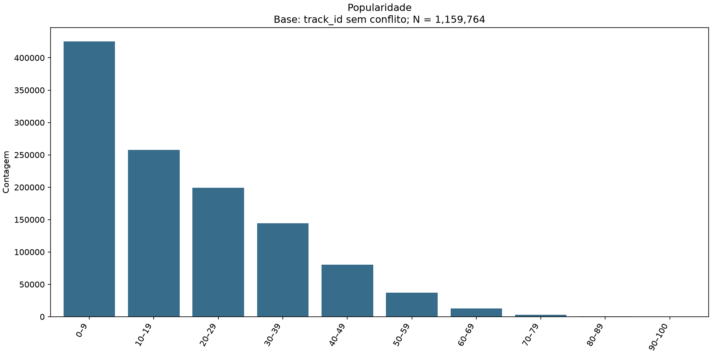
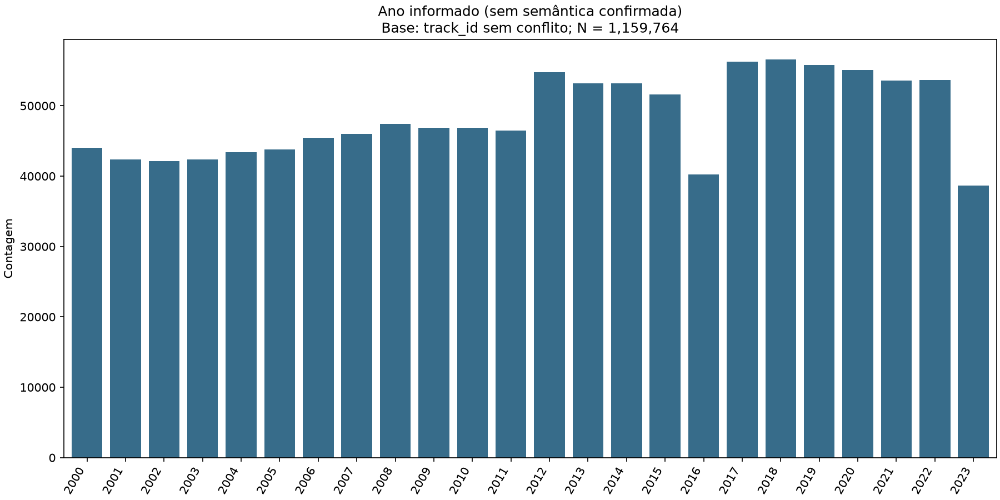
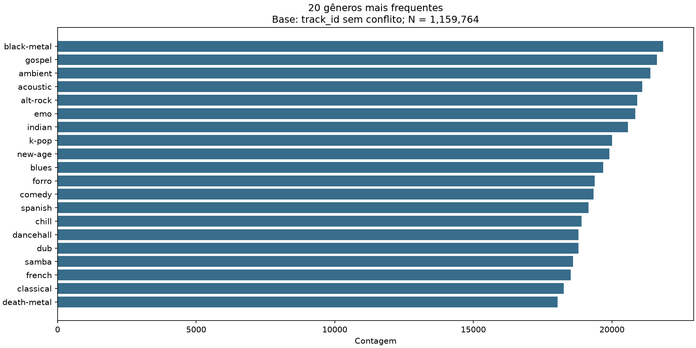
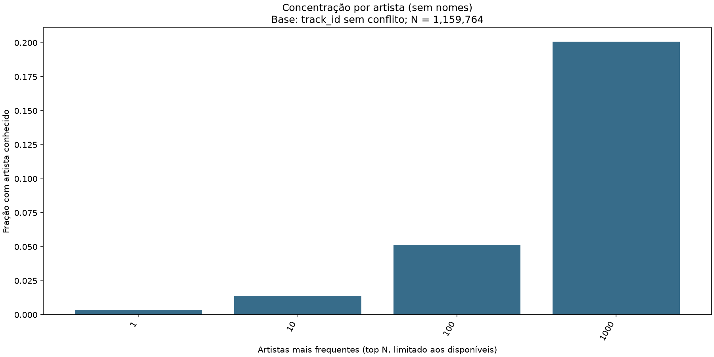
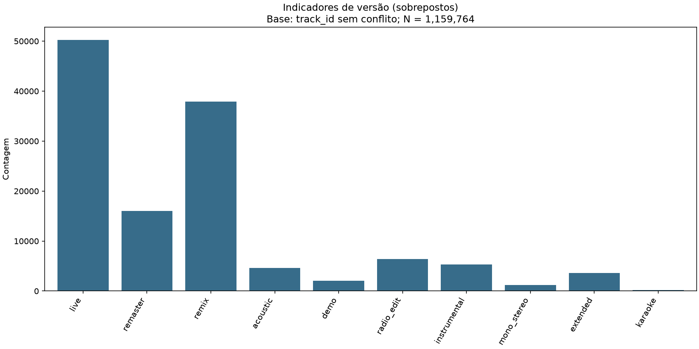
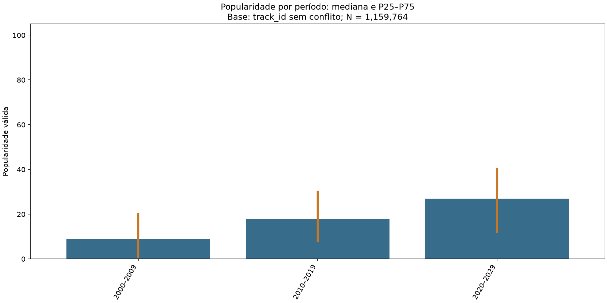

# Auditoria descritiva do catálogo Spotify


Entrada: `C:\Users\Concursos Felipe\Documents\UnB\TCC\data\raw\spotify\spotify_data.csv`. Execução: 2026-10-31T15:16:02.720898+00:00.

## Fonte e alcance

```json
{
  "matches_configured_path": true,
  "evidence": [
    "docs/provenance.md",
    "data/raw/manifest.json",
    "configs/data_sources.example.yaml",
    "src/tcc_music_popularity/acquisition.py"
  ],
  "url": "https://www.kaggle.com/datasets/amitanshjoshi/spotify-1million-tracks",
  "license_documented": "Database: Open Database; Contents: © Original Authors",
  "upstream_updated_at_documented": "2023-06-21T12:27:55.677Z",
  "upstream_version": "não confirmado (não há número de versão registrado)",
  "download_date": "não confirmado: docs indicam 2026-08-18 UTC; manifesto registra reutilização",
  "popularity_collected_at": "não confirmado",
  "year_meaning": "não confirmado; não chamar de ano original de lançamento",
  "historical_rows_not_recounted": 1159764,
  "documented_sha256": "42fff9e85d1b26c3653b4668959d1be395fab8956848f0478bf28f726b3d5897",
  "transformations": "Código de aquisição extrai bytes do CSV do ZIP sem transformação; execução histórica não comprovada por isso. Normalização e matching são derivados separados e não entram nesta auditoria.",
  "manifest_evidence": {
    "sha256": "42fff9e85d1b26c3653b4668959d1be395fab8956848f0478bf28f726b3d5897",
    "size_bytes": 175822041,
    "obtained_or_verified_at": "2026-08-18T01:54:30.425097+00:00",
    "acquisition_method": "reused_existing_configured_file",
    "record_count": null
  }
}
```

## Estrutura, unidade e duplicações

1,159,764 linhas; 20 colunas. Tipos físicos são textuais (CSV); numeric_parseable informa conversibilidade, sem substituir os originais.

| column | inferred_logical_type | missing | missing_percent | numeric_parseable |
| --- | --- | --- | --- | --- |
| source_index_0 | INTEGER | 0 | 0.0000 | 1159764 |
| artist_name | VARCHAR | 15 | 0.0013 | 1025 |
| track_name | VARCHAR | 1 | 0.0001 | 1549 |
| track_id | VARCHAR | 0 | 0.0000 | 0 |
| popularity | INTEGER | 0 | 0.0000 | 1159764 |
| year | INTEGER | 0 | 0.0000 | 1159764 |
| genre | VARCHAR | 0 | 0.0000 | 0 |
| danceability | DOUBLE (pode conter não finitos) | 0 | 0.0000 | 1159764 |
| energy | DOUBLE (pode conter não finitos) | 0 | 0.0000 | 1159764 |
| key | INTEGER | 0 | 0.0000 | 1159764 |
| loudness | DOUBLE (pode conter não finitos) | 0 | 0.0000 | 1159764 |
| mode | INTEGER | 0 | 0.0000 | 1159764 |
| speechiness | DOUBLE (pode conter não finitos) | 0 | 0.0000 | 1159764 |
| acousticness | DOUBLE (pode conter não finitos) | 0 | 0.0000 | 1159764 |
| instrumentalness | DOUBLE (pode conter não finitos) | 0 | 0.0000 | 1159764 |
| liveness | DOUBLE (pode conter não finitos) | 0 | 0.0000 | 1159764 |
| valence | DOUBLE (pode conter não finitos) | 0 | 0.0000 | 1159764 |
| tempo | DOUBLE (pode conter não finitos) | 0 | 0.0000 | 1159764 |
| duration_ms | INTEGER | 0 | 0.0000 | 1159764 |
| time_signature | INTEGER | 0 | 0.0000 | 1159764 |

| metric | n |
| --- | --- |
| distinct_ids | 1159764 |
| repeated_ids | 0 |
| repeated_equal_ids | 0 |
| conflicting_ids | 0 |
| rows_conflicting_ids | 0 |
| rows_repeated_equal_ids | 0 |
| excess_rows_over_distinct_ids | 0 |
| exact_duplicate_excess_rows | 0 |
| exact_duplicate_involved_rows | 0 |
| substantive_duplicate_excess_rows | 0 |
| missing_id_rows | 0 |
| consistent_ids | 1159764 |

IDs com divergência por campo (contagens sobrepostas; não somar):

| field | conflicting_ids |
| --- | --- |
| artist_name | 0 |
| track_name | 0 |
| track_id | 0 |
| popularity | 0 |
| year | 0 |
| genre | 0 |
| danceability | 0 |
| energy | 0 |
| key | 0 |
| loudness | 0 |
| mode | 0 |
| speechiness | 0 |
| acousticness | 0 |
| instrumentalness | 0 |
| liveness | 0 |
| valence | 0 |
| tempo | 0 |
| duration_ms | 0 |
| time_signature | 0 |

Índices ignorados SOMENTE na igualdade substantiva: ['source_index_0']. Igualdade exata compara todos os campos lidos do CSV, inclusive índice; não compara bytes de aspas/terminadores.

`linha` mantém tudo. `track_id_sem_conflito` conta uma vez cada ID cujo registro substantivo é idêntico, sem escolher maior popularidade. IDs conflitantes e ausentes permanecem na base por linha; não há arquivo de rejeitados nem resolução de conflitos. Proposta pendente: investigar a fonte dos conflitos antes de construir a moldura amostral. Não escolher representante até definir regra independente do alvo.

## Base linha: N = 1,159,764

### Identidade, artistas e pares

| distinct_artist_strings | distinct_complete_artist_title_pairs | missing_artist | incomplete_pairs |
| --- | --- | --- | --- |
| 64157 | 1159748 | 15 | 16 |

### Popularidade Spotify

| n_valid | missing | invalid | mean | std_sample | median | q01 | q05 | q25 | q75 | q95 | q99 | zero_count | zero_fraction_valid | zero_fraction_all |
| --- | --- | --- | --- | --- | --- | --- | --- | --- | --- | --- | --- | --- | --- | --- |
| 1159764 | 0 | 0 | 18.3831 | 15.8855 | 15.0000 | 0.0000 | 0.0000 | 5.0000 | 29.0000 | 49.0000 | 62.0000 | 158391 | 0.1366 | 0.1366 |

Domínio: inteiros 0–100; inválidos não entram nos momentos. Frações usam o denominador nomeado; desvio-padrão amostral (n−1).

| band | n | fraction |
| --- | --- | --- |
| 0–9 | 425164 | 0.3666 |
| 10–19 | 257757 | 0.2222 |
| 20–29 | 199251 | 0.1718 |
| 30–39 | 144216 | 0.1243 |
| 40–49 | 80386 | 0.0693 |
| 50–59 | 37040 | 0.0319 |
| 60–69 | 12504 | 0.0108 |
| 70–79 | 2947 | 0.0025 |
| 80–89 | 471 | 0.0004 |
| 90–100 | 28 | 0.0000 |

Limiares cumulativos, sobrepostos (não somar): {"60": 15950, "70": 3446, "80": 499, "90": 28}

### Tempo

Campo `year`: origem CSV; significado não confirmado. Datas parciais são ancoradas em janeiro/dia 1 apenas para cálculo; não indicam precisão diária.

| min_date | max_date | min_year | max_year | missing | invalid | since_2020 |
| --- | --- | --- | --- | --- | --- | --- |
| 2000-01-01 | 2023-01-01 | 2000 | 2023 | 0 | 0 | 200973 |

| precision | n |
| --- | --- |
| ano | 1159764 |

| year | n | n_valid | mean | median | q01 | q05 | q25 | q75 | q95 | q99 |
| --- | --- | --- | --- | --- | --- | --- | --- | --- | --- | --- |
| 2000 | 44034 | 44034 | 10.7362 | 6.0000 | 0.0000 | 0.0000 | 1.0000 | 17.0000 | 36.0000 | 51.0000 |
| 2001 | 42351 | 42351 | 11.2534 | 7.0000 | 0.0000 | 0.0000 | 1.0000 | 17.0000 | 38.0000 | 53.0000 |
| 2002 | 42102 | 42102 | 11.6790 | 8.0000 | 0.0000 | 0.0000 | 1.0000 | 18.0000 | 38.0000 | 53.0000 |
| 2003 | 42368 | 42368 | 12.4357 | 8.0000 | 0.0000 | 0.0000 | 1.0000 | 19.0000 | 39.0000 | 53.0000 |
| 2004 | 43390 | 43390 | 12.2987 | 8.0000 | 0.0000 | 0.0000 | 1.0000 | 19.0000 | 39.0000 | 54.0000 |
| 2005 | 43780 | 43780 | 13.4249 | 10.0000 | 0.0000 | 0.0000 | 2.0000 | 21.0000 | 40.0000 | 54.0000 |
| 2006 | 45474 | 45474 | 13.1379 | 9.0000 | 0.0000 | 0.0000 | 2.0000 | 21.0000 | 40.0000 | 54.0000 |
| 2007 | 46001 | 46001 | 13.4714 | 10.0000 | 0.0000 | 0.0000 | 2.0000 | 21.0000 | 40.0000 | 54.0000 |
| 2008 | 47432 | 47432 | 13.4629 | 10.0000 | 0.0000 | 0.0000 | 2.0000 | 21.0000 | 40.0000 | 54.0000 |
| 2009 | 46869 | 46869 | 14.4046 | 11.0000 | 0.0000 | 0.0000 | 3.0000 | 22.0000 | 40.0000 | 54.0000 |
| 2010 | 46868 | 46868 | 14.8560 | 12.0000 | 0.0000 | 0.0000 | 4.0000 | 22.0000 | 41.0000 | 56.0000 |
| 2011 | 46444 | 46444 | 15.8849 | 13.0000 | 0.0000 | 0.0000 | 5.0000 | 24.0000 | 42.0000 | 56.0000 |
| 2012 | 54797 | 54797 | 16.3599 | 14.0000 | 0.0000 | 0.0000 | 5.0000 | 25.0000 | 43.0000 | 57.0000 |
| 2013 | 53216 | 53216 | 17.5118 | 15.0000 | 0.0000 | 0.0000 | 6.0000 | 26.0000 | 44.0000 | 58.0000 |
| 2014 | 53179 | 53179 | 18.8077 | 17.0000 | 0.0000 | 0.0000 | 7.0000 | 28.0000 | 46.0000 | 59.0000 |
| 2015 | 51607 | 51607 | 20.1151 | 18.0000 | 0.0000 | 0.0000 | 8.0000 | 30.0000 | 48.0000 | 61.0000 |
| 2016 | 40273 | 40273 | 22.3195 | 21.0000 | 0.0000 | 0.0000 | 10.0000 | 32.0000 | 49.0000 | 62.0000 |
| 2017 | 56241 | 56241 | 23.0953 | 22.0000 | 0.0000 | 0.0000 | 10.0000 | 34.0000 | 51.0000 | 64.0000 |
| 2018 | 56572 | 56572 | 24.1612 | 23.0000 | 0.0000 | 0.0000 | 11.0000 | 35.0000 | 53.0000 | 65.0000 |
| 2019 | 55793 | 55793 | 25.6336 | 25.0000 | 0.0000 | 0.0000 | 13.0000 | 37.0000 | 54.0000 | 65.0000 |
| 2020 | 55066 | 55066 | 26.4647 | 26.0000 | 0.0000 | 0.0000 | 13.0000 | 38.0000 | 55.0000 | 66.0000 |
| 2021 | 53566 | 53566 | 28.1518 | 28.0000 | 0.0000 | 0.0000 | 15.0000 | 40.0000 | 57.0000 | 67.0000 |
| 2022 | 53692 | 53692 | 31.0890 | 31.0000 | 0.0000 | 1.0000 | 17.0000 | 44.0000 | 60.0000 | 72.0000 |
| 2023 | 38649 | 38649 | 19.9215 | 17.0000 | 0.0000 | 0.0000 | 2.0000 | 32.0000 | 53.0000 | 67.0000 |

Décadas do campo year (incluem anos 2020 em diante; sem corte em 2023):

| period | n | n_valid | mean | median | q25 | q75 |
| --- | --- | --- | --- | --- | --- | --- |
| 2000–2009 | 443801 | 443801 | 12.6637 | 9.0000 | 1.0000 | 20.0000 |
| 2010–2019 | 514990 | 514990 | 19.9916 | 18.0000 | 8.0000 | 30.0000 |
| 2020–2029 | 200973 | 200973 | 26.8915 | 27.0000 | 12.0000 | 40.0000 |

### Gêneros e concentração

{'missing': 0, 'multi_label_hint_rows': 0, 'distinct_cells': 82, 'representation': 'Uma célula textual por linha; múltiplos rótulos sem semântica confirmada.', 'ids_with_multiple_genre_cells': 0}

| genre | n | fraction | n_valid | mean | median | q25 | q75 |
| --- | --- | --- | --- | --- | --- | --- | --- |
| acoustic | 21097 | 0.0182 | 21097 | 17.8251 | 16.0000 | 7.0000 | 27.0000 |
| afrobeat | 12395 | 0.0107 | 12395 | 8.5600 | 4.0000 | 0.0000 | 13.0000 |
| alt-rock | 20918 | 0.0180 | 20918 | 38.5968 | 37.0000 | 31.0000 | 45.0000 |
| ambient | 21389 | 0.0184 | 21389 | 20.0087 | 20.0000 | 9.0000 | 29.0000 |
| black-metal | 21852 | 0.0188 | 21852 | 11.0900 | 10.0000 | 4.0000 | 16.0000 |
| blues | 19682 | 0.0170 | 19682 | 21.6201 | 20.0000 | 14.0000 | 27.0000 |
| breakbeat | 12256 | 0.0106 | 12256 | 4.2032 | 0.0000 | 0.0000 | 5.0000 |
| cantopop | 15773 | 0.0136 | 15773 | 12.6342 | 10.0000 | 5.0000 | 18.0000 |
| chicago-house | 5170 | 0.0045 | 5170 | 3.2605 | 0.0000 | 0.0000 | 3.0000 |
| chill | 18906 | 0.0163 | 18906 | 25.9052 | 27.0000 | 11.2500 | 40.0000 |
| classical | 18259 | 0.0157 | 18259 | 24.9033 | 24.0000 | 18.0000 | 31.0000 |
| club | 14678 | 0.0127 | 14678 | 11.3600 | 8.0000 | 0.0000 | 19.0000 |
| comedy | 19334 | 0.0167 | 19334 | 10.0068 | 8.0000 | 3.0000 | 15.0000 |
| country | 17883 | 0.0154 | 17883 | 33.0474 | 31.0000 | 22.0000 | 41.0000 |
| dance | 17212 | 0.0148 | 17212 | 43.0343 | 43.0000 | 32.0000 | 53.0000 |
| dancehall | 18788 | 0.0162 | 18788 | 14.6776 | 13.0000 | 5.0000 | 23.0000 |
| death-metal | 18038 | 0.0156 | 18038 | 19.2582 | 18.0000 | 12.0000 | 25.0000 |
| deep-house | 17896 | 0.0154 | 17896 | 17.1037 | 15.0000 | 1.0000 | 29.0000 |
| detroit-techno | 3920 | 0.0034 | 3920 | 2.9538 | 0.0000 | 0.0000 | 3.0000 |
| disco | 16987 | 0.0146 | 16987 | 17.4103 | 16.0000 | 7.0000 | 26.0000 |
| drum-and-bass | 14591 | 0.0126 | 14591 | 10.6806 | 8.0000 | 1.0000 | 16.0000 |
| dub | 18785 | 0.0162 | 18785 | 16.1478 | 15.0000 | 5.0000 | 26.0000 |
| dubstep | 4774 | 0.0041 | 4774 | 3.5094 | 1.0000 | 0.0000 | 5.0000 |
| edm | 10671 | 0.0092 | 10671 | 23.8898 | 24.0000 | 5.0000 | 39.0000 |
| electro | 11406 | 0.0098 | 11406 | 31.4503 | 30.0000 | 20.0000 | 43.0000 |
| electronic | 9369 | 0.0081 | 9369 | 24.4923 | 26.0000 | 14.0000 | 34.0000 |
| emo | 20845 | 0.0180 | 20845 | 23.6620 | 23.0000 | 12.0000 | 34.0000 |
| folk | 16170 | 0.0139 | 16170 | 33.4485 | 33.0000 | 25.0000 | 40.0000 |
| forro | 19379 | 0.0167 | 19379 | 11.3713 | 6.0000 | 0.0000 | 17.0000 |
| french | 18519 | 0.0160 | 18519 | 26.4626 | 26.0000 | 12.0000 | 38.0000 |
| funk | 15136 | 0.0131 | 15136 | 26.3934 | 24.0000 | 16.0000 | 34.0000 |
| garage | 17123 | 0.0148 | 17123 | 16.6847 | 16.0000 | 5.0000 | 25.0000 |
| german | 16417 | 0.0142 | 16417 | 24.2672 | 21.0000 | 13.0000 | 33.0000 |
| gospel | 21621 | 0.0186 | 21621 | 18.9204 | 16.0000 | 11.0000 | 25.0000 |
| goth | 17381 | 0.0150 | 17381 | 11.4774 | 9.0000 | 4.0000 | 16.0000 |
| grindcore | 14509 | 0.0125 | 14509 | 2.6478 | 1.0000 | 0.0000 | 3.0000 |
| groove | 13366 | 0.0115 | 13366 | 11.6597 | 9.0000 | 1.0000 | 19.0000 |
| guitar | 17266 | 0.0149 | 17266 | 9.4468 | 7.0000 | 2.0000 | 14.0000 |
| hard-rock | 13800 | 0.0119 | 13800 | 20.4895 | 19.0000 | 13.0000 | 26.0000 |
| hardcore | 15993 | 0.0138 | 15993 | 26.1735 | 25.0000 | 19.0000 | 31.0000 |
| hardstyle | 12420 | 0.0107 | 12420 | 15.1840 | 12.0000 | 2.0000 | 24.0000 |
| heavy-metal | 14862 | 0.0128 | 14862 | 4.4838 | 1.0000 | 0.0000 | 6.0000 |
| hip-hop | 15703 | 0.0135 | 15703 | 46.3157 | 47.0000 | 36.0000 | 56.0000 |
| house | 5233 | 0.0045 | 5233 | 23.0801 | 19.0000 | 8.0000 | 36.0000 |
| indian | 20583 | 0.0177 | 20583 | 8.7905 | 2.0000 | 0.0000 | 14.0000 |
| indie-pop | 10022 | 0.0086 | 10022 | 35.5183 | 38.0000 | 21.0000 | 48.0000 |
| industrial | 15245 | 0.0131 | 15245 | 11.5877 | 10.0000 | 5.0000 | 16.0000 |
| jazz | 15943 | 0.0137 | 15943 | 30.4337 | 30.0000 | 22.0000 | 38.0000 |
| k-pop | 20004 | 0.0172 | 20004 | 27.7362 | 27.0000 | 14.0000 | 40.0000 |
| metal | 7020 | 0.0061 | 7020 | 39.6989 | 38.0000 | 33.0000 | 45.0000 |
| metalcore | 6267 | 0.0054 | 6267 | 16.3241 | 18.0000 | 7.0000 | 25.0000 |
| minimal-techno | 15198 | 0.0131 | 15198 | 8.4759 | 7.0000 | 0.0000 | 14.0000 |
| new-age | 19911 | 0.0172 | 19911 | 11.6399 | 9.0000 | 4.0000 | 16.0000 |
| opera | 15079 | 0.0130 | 15079 | 7.2762 | 4.0000 | 0.0000 | 11.0000 |
| party | 9548 | 0.0082 | 9548 | 8.8008 | 5.0000 | 0.0000 | 12.0000 |
| piano | 13784 | 0.0119 | 13784 | 19.6332 | 17.0000 | 8.0000 | 30.0000 |
| pop | 6235 | 0.0054 | 6235 | 55.6858 | 56.0000 | 47.0000 | 64.0000 |
| pop-film | 16907 | 0.0146 | 16907 | 17.3945 | 14.0000 | 0.0000 | 29.0000 |
| power-pop | 17161 | 0.0148 | 17161 | 4.6142 | 2.0000 | 0.0000 | 7.0000 |
| progressive-house | 10589 | 0.0091 | 10589 | 16.7325 | 16.0000 | 1.0000 | 29.0000 |
| psych-rock | 12789 | 0.0110 | 12789 | 14.8492 | 13.0000 | 8.0000 | 20.0000 |
| punk | 6197 | 0.0053 | 6197 | 31.3673 | 31.0000 | 25.0000 | 37.0000 |
| punk-rock | 7086 | 0.0061 | 7086 | 19.4577 | 18.0000 | 13.0000 | 25.0000 |
| rock | 3319 | 0.0029 | 3319 | 46.2290 | 47.0000 | 41.0000 | 53.0000 |
| rock-n-roll | 15891 | 0.0137 | 15891 | 8.1736 | 6.0000 | 1.0000 | 12.0000 |
| romance | 6518 | 0.0056 | 6518 | 0.6594 | 0.0000 | 0.0000 | 0.0000 |
| sad | 6086 | 0.0052 | 6086 | 36.1222 | 37.0000 | 24.0000 | 48.0000 |
| salsa | 17501 | 0.0151 | 17501 | 12.0543 | 9.0000 | 3.0000 | 18.0000 |
| samba | 18599 | 0.0160 | 18599 | 9.6476 | 5.0000 | 1.0000 | 15.0000 |
| sertanejo | 17566 | 0.0151 | 17566 | 20.1697 | 16.0000 | 5.0000 | 33.0000 |
| show-tunes | 11101 | 0.0096 | 11101 | 10.0275 | 4.0000 | 0.0000 | 15.0000 |
| singer-songwriter | 14035 | 0.0121 | 14035 | 23.4211 | 21.0000 | 13.0000 | 31.0000 |
| ska | 13776 | 0.0119 | 13776 | 14.8043 | 12.0000 | 8.0000 | 19.0000 |
| sleep | 17851 | 0.0154 | 17851 | 14.8712 | 12.0000 | 0.0000 | 24.0000 |
| songwriter | 589 | 0.0005 | 589 | 13.6231 | 11.0000 | 7.0000 | 16.0000 |
| soul | 8974 | 0.0077 | 8974 | 30.3871 | 30.0000 | 19.0000 | 40.0000 |
| spanish | 19158 | 0.0165 | 19158 | 23.6039 | 24.0000 | 11.0000 | 34.0000 |
| swedish | 11616 | 0.0100 | 11616 | 19.9313 | 17.0000 | 10.0000 | 28.0000 |
| tango | 15069 | 0.0130 | 15069 | 2.5233 | 0.0000 | 0.0000 | 2.0000 |
| techno | 7898 | 0.0068 | 7898 | 14.7050 | 13.0000 | 2.0000 | 24.0000 |
| trance | 9592 | 0.0083 | 9592 | 14.9160 | 13.0000 | 3.0000 | 24.0000 |
| trip-hop | 11285 | 0.0097 | 11285 | 6.5381 | 3.0000 | 0.0000 | 10.0000 |

Distribuição de faixas/linhas por string de artista (nomes não publicados):

| n_valid | min | max | mean | median | q25 | q75 | q95 | q99 |
| --- | --- | --- | --- | --- | --- | --- | --- | --- |
| 64157 | 1 | 4058 | 18.0767 | 6.0000 | 2.0000 | 18.0000 | 75.0000 | 167.0000 |

| top_requested | artists_included | n | fraction_known_artist | fraction_all |
| --- | --- | --- | --- | --- |
| 1 | 1 | 4058 | 0.0035 | 0.0035 |
| 10 | 10 | 15871 | 0.0137 | 0.0137 |
| 100 | 100 | 59763 | 0.0515 | 0.0515 |
| 1000 | 1000 | 232960 | 0.2009 | 0.2009 |

### Versões e acústica

Flags de título sobrepostas; nenhuma versão é excluída.

| flag | n | fraction | regex |
| --- | --- | --- | --- |
| live | 50267 | 0.0433 | \blive\b\|\bao vivo\b |
| remaster | 15984 | 0.0138 | \bremaster(ed\|izado\|izada)?\b |
| remix | 37932 | 0.0327 | \bremix(ed)?\b |
| acoustic | 4580 | 0.0039 | \bacoustic\b\|\bac[uú]stic[oa]\b\|\bunplugged\b |
| demo | 2086 | 0.0018 | \bdemo\b |
| radio_edit | 6377 | 0.0055 | \bradio[ -]edit\b |
| instrumental | 5299 | 0.0046 | \binstrumental\b |
| mono_stereo | 1215 | 0.0010 | \b(mono\|stereo)\b |
| extended | 3578 | 0.0031 | \bextended\b |
| karaoke | 168 | 0.0001 | \bkaraoke\b |

| field | domain | missing | invalid_parse | out_of_domain | n_valid | min | max | mean | median | q01 | q05 | q25 | q75 | q95 | q99 |
| --- | --- | --- | --- | --- | --- | --- | --- | --- | --- | --- | --- | --- | --- | --- | --- |
| danceability | [0, 1] | 0 | 0 | 0 | 1159764 | 0.0000 | 0.9930 | 0.5374 | 0.5500 | 0.1090 | 0.2040 | 0.4130 | 0.6770 | 0.8110 | 0.8880 |
| energy | [0, 1] | 0 | 0 | 0 | 1159764 | 0.0000 | 1.0000 | 0.6397 | 0.6940 | 0.0180 | 0.1100 | 0.4540 | 0.8730 | 0.9760 | 0.9940 |
| key | [-1, 0, 1, 2, 3, 4, 5, 6, 7, 8, 9, 10, 11] | 0 | 0 | 0 | 1159764 | 0.0000 | 11.0000 | 5.2878 | 5.0000 | 0.0000 | 0.0000 | 2.0000 | 8.0000 | 11.0000 | 11.0000 |
| loudness | Sem limites documentados; apenas parse/valor finito verificados. | 0 | 0 | 0 | 1159764 | -58.1000 | 6.1720 | -8.9814 | -7.4500 | -29.9280 | -20.8970 | -10.8290 | -5.2760 | -3.1470 | -1.7980 |
| mode | [0, 1] | 0 | 0 | 0 | 1159764 | 0.0000 | 1.0000 | 0.6347 | 1.0000 | 0.0000 | 0.0000 | 0.0000 | 1.0000 | 1.0000 | 1.0000 |
| speechiness | [0, 1] | 0 | 0 | 0 | 1159764 | 0.0000 | 0.9710 | 0.0928 | 0.0507 | 0.0257 | 0.0287 | 0.0371 | 0.0890 | 0.2980 | 0.9050 |
| acousticness | [0, 1] | 0 | 0 | 0 | 1159764 | 0.0000 | 0.9960 | 0.3215 | 0.1470 | 0.0000 | 0.0000 | 0.0064 | 0.6400 | 0.9760 | 0.9940 |
| instrumentalness | [0, 1] | 0 | 0 | 0 | 1159764 | 0.0000 | 1.0000 | 0.2523 | 0.0018 | 0.0000 | 0.0000 | 0.0000 | 0.6140 | 0.9230 | 0.9610 |
| liveness | [0, 1] | 0 | 0 | 0 | 1159764 | 0.0000 | 1.0000 | 0.2230 | 0.1340 | 0.0385 | 0.0604 | 0.0979 | 0.2920 | 0.7080 | 0.9530 |
| valence | [0, 1] | 0 | 0 | 0 | 1159764 | 0.0000 | 1.0000 | 0.4556 | 0.4380 | 0.0328 | 0.0509 | 0.2260 | 0.6740 | 0.9100 | 0.9650 |
| tempo | > 0 | 0 | 0 | 1199 | 1158565 | 30.7660 | 249.9930 | 121.5028 | 121.9560 | 65.3500 | 76.6750 | 98.9130 | 139.9110 | 174.8930 | 193.5424 |
| duration_ms | > 0 | 0 | 0 | 0 | 1159764 | 2073.0000 | 6000495.0000 | 249561.7812 | 225744.0000 | 57307.0000 | 109293.0000 | 181091.0000 | 286913.5000 | 448000.0000 | 654246.6100 |
| time_signature | [0, 1, 2, 3, 4, 5, 6, 7] | 0 | 0 | 0 | 1159764 | 0.0000 | 5.0000 | 3.8859 | 4.0000 | 1.0000 | 3.0000 | 4.0000 | 4.0000 | 4.0000 | 5.0000 |

Domínios acústicos vêm das regras locais registradas; loudness não tem limite numérico documentado. JSON/CSV também resumem todos os valores finitos, inclusive fora do domínio.

Cruzamentos período × gênero, período × faixa de popularidade e triplo: contagens e métricas completas no JSON/CSV; células observadas abaixo no diagnóstico amostral.

## Base track_id_sem_conflito: N = 1,159,764

### Identidade, artistas e pares

| distinct_artist_strings | distinct_complete_artist_title_pairs | missing_artist | incomplete_pairs |
| --- | --- | --- | --- |
| 64157 | 1159748 | 15 | 16 |

### Popularidade Spotify

| n_valid | missing | invalid | mean | std_sample | median | q01 | q05 | q25 | q75 | q95 | q99 | zero_count | zero_fraction_valid | zero_fraction_all |
| --- | --- | --- | --- | --- | --- | --- | --- | --- | --- | --- | --- | --- | --- | --- |
| 1159764 | 0 | 0 | 18.3831 | 15.8855 | 15.0000 | 0.0000 | 0.0000 | 5.0000 | 29.0000 | 49.0000 | 62.0000 | 158391 | 0.1366 | 0.1366 |

Domínio: inteiros 0–100; inválidos não entram nos momentos. Frações usam o denominador nomeado; desvio-padrão amostral (n−1).

| band | n | fraction |
| --- | --- | --- |
| 0–9 | 425164 | 0.3666 |
| 10–19 | 257757 | 0.2222 |
| 20–29 | 199251 | 0.1718 |
| 30–39 | 144216 | 0.1243 |
| 40–49 | 80386 | 0.0693 |
| 50–59 | 37040 | 0.0319 |
| 60–69 | 12504 | 0.0108 |
| 70–79 | 2947 | 0.0025 |
| 80–89 | 471 | 0.0004 |
| 90–100 | 28 | 0.0000 |

Limiares cumulativos, sobrepostos (não somar): {"60": 15950, "70": 3446, "80": 499, "90": 28}

### Tempo

Campo `year`: origem CSV; significado não confirmado. Datas parciais são ancoradas em janeiro/dia 1 apenas para cálculo; não indicam precisão diária.

| min_date | max_date | min_year | max_year | missing | invalid | since_2020 |
| --- | --- | --- | --- | --- | --- | --- |
| 2000-01-01 | 2023-01-01 | 2000 | 2023 | 0 | 0 | 200973 |

| precision | n |
| --- | --- |
| ano | 1159764 |

| year | n | n_valid | mean | median | q01 | q05 | q25 | q75 | q95 | q99 |
| --- | --- | --- | --- | --- | --- | --- | --- | --- | --- | --- |
| 2000 | 44034 | 44034 | 10.7362 | 6.0000 | 0.0000 | 0.0000 | 1.0000 | 17.0000 | 36.0000 | 51.0000 |
| 2001 | 42351 | 42351 | 11.2534 | 7.0000 | 0.0000 | 0.0000 | 1.0000 | 17.0000 | 38.0000 | 53.0000 |
| 2002 | 42102 | 42102 | 11.6790 | 8.0000 | 0.0000 | 0.0000 | 1.0000 | 18.0000 | 38.0000 | 53.0000 |
| 2003 | 42368 | 42368 | 12.4357 | 8.0000 | 0.0000 | 0.0000 | 1.0000 | 19.0000 | 39.0000 | 53.0000 |
| 2004 | 43390 | 43390 | 12.2987 | 8.0000 | 0.0000 | 0.0000 | 1.0000 | 19.0000 | 39.0000 | 54.0000 |
| 2005 | 43780 | 43780 | 13.4249 | 10.0000 | 0.0000 | 0.0000 | 2.0000 | 21.0000 | 40.0000 | 54.0000 |
| 2006 | 45474 | 45474 | 13.1379 | 9.0000 | 0.0000 | 0.0000 | 2.0000 | 21.0000 | 40.0000 | 54.0000 |
| 2007 | 46001 | 46001 | 13.4714 | 10.0000 | 0.0000 | 0.0000 | 2.0000 | 21.0000 | 40.0000 | 54.0000 |
| 2008 | 47432 | 47432 | 13.4629 | 10.0000 | 0.0000 | 0.0000 | 2.0000 | 21.0000 | 40.0000 | 54.0000 |
| 2009 | 46869 | 46869 | 14.4046 | 11.0000 | 0.0000 | 0.0000 | 3.0000 | 22.0000 | 40.0000 | 54.0000 |
| 2010 | 46868 | 46868 | 14.8560 | 12.0000 | 0.0000 | 0.0000 | 4.0000 | 22.0000 | 41.0000 | 56.0000 |
| 2011 | 46444 | 46444 | 15.8849 | 13.0000 | 0.0000 | 0.0000 | 5.0000 | 24.0000 | 42.0000 | 56.0000 |
| 2012 | 54797 | 54797 | 16.3599 | 14.0000 | 0.0000 | 0.0000 | 5.0000 | 25.0000 | 43.0000 | 57.0000 |
| 2013 | 53216 | 53216 | 17.5118 | 15.0000 | 0.0000 | 0.0000 | 6.0000 | 26.0000 | 44.0000 | 58.0000 |
| 2014 | 53179 | 53179 | 18.8077 | 17.0000 | 0.0000 | 0.0000 | 7.0000 | 28.0000 | 46.0000 | 59.0000 |
| 2015 | 51607 | 51607 | 20.1151 | 18.0000 | 0.0000 | 0.0000 | 8.0000 | 30.0000 | 48.0000 | 61.0000 |
| 2016 | 40273 | 40273 | 22.3195 | 21.0000 | 0.0000 | 0.0000 | 10.0000 | 32.0000 | 49.0000 | 62.0000 |
| 2017 | 56241 | 56241 | 23.0953 | 22.0000 | 0.0000 | 0.0000 | 10.0000 | 34.0000 | 51.0000 | 64.0000 |
| 2018 | 56572 | 56572 | 24.1612 | 23.0000 | 0.0000 | 0.0000 | 11.0000 | 35.0000 | 53.0000 | 65.0000 |
| 2019 | 55793 | 55793 | 25.6336 | 25.0000 | 0.0000 | 0.0000 | 13.0000 | 37.0000 | 54.0000 | 65.0000 |
| 2020 | 55066 | 55066 | 26.4647 | 26.0000 | 0.0000 | 0.0000 | 13.0000 | 38.0000 | 55.0000 | 66.0000 |
| 2021 | 53566 | 53566 | 28.1518 | 28.0000 | 0.0000 | 0.0000 | 15.0000 | 40.0000 | 57.0000 | 67.0000 |
| 2022 | 53692 | 53692 | 31.0890 | 31.0000 | 0.0000 | 1.0000 | 17.0000 | 44.0000 | 60.0000 | 72.0000 |
| 2023 | 38649 | 38649 | 19.9215 | 17.0000 | 0.0000 | 0.0000 | 2.0000 | 32.0000 | 53.0000 | 67.0000 |

Décadas do campo year (incluem anos 2020 em diante; sem corte em 2023):

| period | n | n_valid | mean | median | q25 | q75 |
| --- | --- | --- | --- | --- | --- | --- |
| 2000–2009 | 443801 | 443801 | 12.6637 | 9.0000 | 1.0000 | 20.0000 |
| 2010–2019 | 514990 | 514990 | 19.9916 | 18.0000 | 8.0000 | 30.0000 |
| 2020–2029 | 200973 | 200973 | 26.8915 | 27.0000 | 12.0000 | 40.0000 |

### Gêneros e concentração

{'missing': 0, 'multi_label_hint_rows': 0, 'distinct_cells': 82, 'representation': 'Uma célula textual por linha; múltiplos rótulos sem semântica confirmada.'}

| genre | n | fraction | n_valid | mean | median | q25 | q75 |
| --- | --- | --- | --- | --- | --- | --- | --- |
| acoustic | 21097 | 0.0182 | 21097 | 17.8251 | 16.0000 | 7.0000 | 27.0000 |
| afrobeat | 12395 | 0.0107 | 12395 | 8.5600 | 4.0000 | 0.0000 | 13.0000 |
| alt-rock | 20918 | 0.0180 | 20918 | 38.5968 | 37.0000 | 31.0000 | 45.0000 |
| ambient | 21389 | 0.0184 | 21389 | 20.0087 | 20.0000 | 9.0000 | 29.0000 |
| black-metal | 21852 | 0.0188 | 21852 | 11.0900 | 10.0000 | 4.0000 | 16.0000 |
| blues | 19682 | 0.0170 | 19682 | 21.6201 | 20.0000 | 14.0000 | 27.0000 |
| breakbeat | 12256 | 0.0106 | 12256 | 4.2032 | 0.0000 | 0.0000 | 5.0000 |
| cantopop | 15773 | 0.0136 | 15773 | 12.6342 | 10.0000 | 5.0000 | 18.0000 |
| chicago-house | 5170 | 0.0045 | 5170 | 3.2605 | 0.0000 | 0.0000 | 3.0000 |
| chill | 18906 | 0.0163 | 18906 | 25.9052 | 27.0000 | 11.2500 | 40.0000 |
| classical | 18259 | 0.0157 | 18259 | 24.9033 | 24.0000 | 18.0000 | 31.0000 |
| club | 14678 | 0.0127 | 14678 | 11.3600 | 8.0000 | 0.0000 | 19.0000 |
| comedy | 19334 | 0.0167 | 19334 | 10.0068 | 8.0000 | 3.0000 | 15.0000 |
| country | 17883 | 0.0154 | 17883 | 33.0474 | 31.0000 | 22.0000 | 41.0000 |
| dance | 17212 | 0.0148 | 17212 | 43.0343 | 43.0000 | 32.0000 | 53.0000 |
| dancehall | 18788 | 0.0162 | 18788 | 14.6776 | 13.0000 | 5.0000 | 23.0000 |
| death-metal | 18038 | 0.0156 | 18038 | 19.2582 | 18.0000 | 12.0000 | 25.0000 |
| deep-house | 17896 | 0.0154 | 17896 | 17.1037 | 15.0000 | 1.0000 | 29.0000 |
| detroit-techno | 3920 | 0.0034 | 3920 | 2.9538 | 0.0000 | 0.0000 | 3.0000 |
| disco | 16987 | 0.0146 | 16987 | 17.4103 | 16.0000 | 7.0000 | 26.0000 |
| drum-and-bass | 14591 | 0.0126 | 14591 | 10.6806 | 8.0000 | 1.0000 | 16.0000 |
| dub | 18785 | 0.0162 | 18785 | 16.1478 | 15.0000 | 5.0000 | 26.0000 |
| dubstep | 4774 | 0.0041 | 4774 | 3.5094 | 1.0000 | 0.0000 | 5.0000 |
| edm | 10671 | 0.0092 | 10671 | 23.8898 | 24.0000 | 5.0000 | 39.0000 |
| electro | 11406 | 0.0098 | 11406 | 31.4503 | 30.0000 | 20.0000 | 43.0000 |
| electronic | 9369 | 0.0081 | 9369 | 24.4923 | 26.0000 | 14.0000 | 34.0000 |
| emo | 20845 | 0.0180 | 20845 | 23.6620 | 23.0000 | 12.0000 | 34.0000 |
| folk | 16170 | 0.0139 | 16170 | 33.4485 | 33.0000 | 25.0000 | 40.0000 |
| forro | 19379 | 0.0167 | 19379 | 11.3713 | 6.0000 | 0.0000 | 17.0000 |
| french | 18519 | 0.0160 | 18519 | 26.4626 | 26.0000 | 12.0000 | 38.0000 |
| funk | 15136 | 0.0131 | 15136 | 26.3934 | 24.0000 | 16.0000 | 34.0000 |
| garage | 17123 | 0.0148 | 17123 | 16.6847 | 16.0000 | 5.0000 | 25.0000 |
| german | 16417 | 0.0142 | 16417 | 24.2672 | 21.0000 | 13.0000 | 33.0000 |
| gospel | 21621 | 0.0186 | 21621 | 18.9204 | 16.0000 | 11.0000 | 25.0000 |
| goth | 17381 | 0.0150 | 17381 | 11.4774 | 9.0000 | 4.0000 | 16.0000 |
| grindcore | 14509 | 0.0125 | 14509 | 2.6478 | 1.0000 | 0.0000 | 3.0000 |
| groove | 13366 | 0.0115 | 13366 | 11.6597 | 9.0000 | 1.0000 | 19.0000 |
| guitar | 17266 | 0.0149 | 17266 | 9.4468 | 7.0000 | 2.0000 | 14.0000 |
| hard-rock | 13800 | 0.0119 | 13800 | 20.4895 | 19.0000 | 13.0000 | 26.0000 |
| hardcore | 15993 | 0.0138 | 15993 | 26.1735 | 25.0000 | 19.0000 | 31.0000 |
| hardstyle | 12420 | 0.0107 | 12420 | 15.1840 | 12.0000 | 2.0000 | 24.0000 |
| heavy-metal | 14862 | 0.0128 | 14862 | 4.4838 | 1.0000 | 0.0000 | 6.0000 |
| hip-hop | 15703 | 0.0135 | 15703 | 46.3157 | 47.0000 | 36.0000 | 56.0000 |
| house | 5233 | 0.0045 | 5233 | 23.0801 | 19.0000 | 8.0000 | 36.0000 |
| indian | 20583 | 0.0177 | 20583 | 8.7905 | 2.0000 | 0.0000 | 14.0000 |
| indie-pop | 10022 | 0.0086 | 10022 | 35.5183 | 38.0000 | 21.0000 | 48.0000 |
| industrial | 15245 | 0.0131 | 15245 | 11.5877 | 10.0000 | 5.0000 | 16.0000 |
| jazz | 15943 | 0.0137 | 15943 | 30.4337 | 30.0000 | 22.0000 | 38.0000 |
| k-pop | 20004 | 0.0172 | 20004 | 27.7362 | 27.0000 | 14.0000 | 40.0000 |
| metal | 7020 | 0.0061 | 7020 | 39.6989 | 38.0000 | 33.0000 | 45.0000 |
| metalcore | 6267 | 0.0054 | 6267 | 16.3241 | 18.0000 | 7.0000 | 25.0000 |
| minimal-techno | 15198 | 0.0131 | 15198 | 8.4759 | 7.0000 | 0.0000 | 14.0000 |
| new-age | 19911 | 0.0172 | 19911 | 11.6399 | 9.0000 | 4.0000 | 16.0000 |
| opera | 15079 | 0.0130 | 15079 | 7.2762 | 4.0000 | 0.0000 | 11.0000 |
| party | 9548 | 0.0082 | 9548 | 8.8008 | 5.0000 | 0.0000 | 12.0000 |
| piano | 13784 | 0.0119 | 13784 | 19.6332 | 17.0000 | 8.0000 | 30.0000 |
| pop | 6235 | 0.0054 | 6235 | 55.6858 | 56.0000 | 47.0000 | 64.0000 |
| pop-film | 16907 | 0.0146 | 16907 | 17.3945 | 14.0000 | 0.0000 | 29.0000 |
| power-pop | 17161 | 0.0148 | 17161 | 4.6142 | 2.0000 | 0.0000 | 7.0000 |
| progressive-house | 10589 | 0.0091 | 10589 | 16.7325 | 16.0000 | 1.0000 | 29.0000 |
| psych-rock | 12789 | 0.0110 | 12789 | 14.8492 | 13.0000 | 8.0000 | 20.0000 |
| punk | 6197 | 0.0053 | 6197 | 31.3673 | 31.0000 | 25.0000 | 37.0000 |
| punk-rock | 7086 | 0.0061 | 7086 | 19.4577 | 18.0000 | 13.0000 | 25.0000 |
| rock | 3319 | 0.0029 | 3319 | 46.2290 | 47.0000 | 41.0000 | 53.0000 |
| rock-n-roll | 15891 | 0.0137 | 15891 | 8.1736 | 6.0000 | 1.0000 | 12.0000 |
| romance | 6518 | 0.0056 | 6518 | 0.6594 | 0.0000 | 0.0000 | 0.0000 |
| sad | 6086 | 0.0052 | 6086 | 36.1222 | 37.0000 | 24.0000 | 48.0000 |
| salsa | 17501 | 0.0151 | 17501 | 12.0543 | 9.0000 | 3.0000 | 18.0000 |
| samba | 18599 | 0.0160 | 18599 | 9.6476 | 5.0000 | 1.0000 | 15.0000 |
| sertanejo | 17566 | 0.0151 | 17566 | 20.1697 | 16.0000 | 5.0000 | 33.0000 |
| show-tunes | 11101 | 0.0096 | 11101 | 10.0275 | 4.0000 | 0.0000 | 15.0000 |
| singer-songwriter | 14035 | 0.0121 | 14035 | 23.4211 | 21.0000 | 13.0000 | 31.0000 |
| ska | 13776 | 0.0119 | 13776 | 14.8043 | 12.0000 | 8.0000 | 19.0000 |
| sleep | 17851 | 0.0154 | 17851 | 14.8712 | 12.0000 | 0.0000 | 24.0000 |
| songwriter | 589 | 0.0005 | 589 | 13.6231 | 11.0000 | 7.0000 | 16.0000 |
| soul | 8974 | 0.0077 | 8974 | 30.3871 | 30.0000 | 19.0000 | 40.0000 |
| spanish | 19158 | 0.0165 | 19158 | 23.6039 | 24.0000 | 11.0000 | 34.0000 |
| swedish | 11616 | 0.0100 | 11616 | 19.9313 | 17.0000 | 10.0000 | 28.0000 |
| tango | 15069 | 0.0130 | 15069 | 2.5233 | 0.0000 | 0.0000 | 2.0000 |
| techno | 7898 | 0.0068 | 7898 | 14.7050 | 13.0000 | 2.0000 | 24.0000 |
| trance | 9592 | 0.0083 | 9592 | 14.9160 | 13.0000 | 3.0000 | 24.0000 |
| trip-hop | 11285 | 0.0097 | 11285 | 6.5381 | 3.0000 | 0.0000 | 10.0000 |

Distribuição de faixas/linhas por string de artista (nomes não publicados):

| n_valid | min | max | mean | median | q25 | q75 | q95 | q99 |
| --- | --- | --- | --- | --- | --- | --- | --- | --- |
| 64157 | 1 | 4058 | 18.0767 | 6.0000 | 2.0000 | 18.0000 | 75.0000 | 167.0000 |

| top_requested | artists_included | n | fraction_known_artist | fraction_all |
| --- | --- | --- | --- | --- |
| 1 | 1 | 4058 | 0.0035 | 0.0035 |
| 10 | 10 | 15871 | 0.0137 | 0.0137 |
| 100 | 100 | 59763 | 0.0515 | 0.0515 |
| 1000 | 1000 | 232960 | 0.2009 | 0.2009 |

### Versões e acústica

Flags de título sobrepostas; nenhuma versão é excluída.

| flag | n | fraction | regex |
| --- | --- | --- | --- |
| live | 50267 | 0.0433 | \blive\b\|\bao vivo\b |
| remaster | 15984 | 0.0138 | \bremaster(ed\|izado\|izada)?\b |
| remix | 37932 | 0.0327 | \bremix(ed)?\b |
| acoustic | 4580 | 0.0039 | \bacoustic\b\|\bac[uú]stic[oa]\b\|\bunplugged\b |
| demo | 2086 | 0.0018 | \bdemo\b |
| radio_edit | 6377 | 0.0055 | \bradio[ -]edit\b |
| instrumental | 5299 | 0.0046 | \binstrumental\b |
| mono_stereo | 1215 | 0.0010 | \b(mono\|stereo)\b |
| extended | 3578 | 0.0031 | \bextended\b |
| karaoke | 168 | 0.0001 | \bkaraoke\b |

| field | domain | missing | invalid_parse | out_of_domain | n_valid | min | max | mean | median | q01 | q05 | q25 | q75 | q95 | q99 |
| --- | --- | --- | --- | --- | --- | --- | --- | --- | --- | --- | --- | --- | --- | --- | --- |
| danceability | [0, 1] | 0 | 0 | 0 | 1159764 | 0.0000 | 0.9930 | 0.5374 | 0.5500 | 0.1090 | 0.2040 | 0.4130 | 0.6770 | 0.8110 | 0.8880 |
| energy | [0, 1] | 0 | 0 | 0 | 1159764 | 0.0000 | 1.0000 | 0.6397 | 0.6940 | 0.0180 | 0.1100 | 0.4540 | 0.8730 | 0.9760 | 0.9940 |
| key | [-1, 0, 1, 2, 3, 4, 5, 6, 7, 8, 9, 10, 11] | 0 | 0 | 0 | 1159764 | 0.0000 | 11.0000 | 5.2878 | 5.0000 | 0.0000 | 0.0000 | 2.0000 | 8.0000 | 11.0000 | 11.0000 |
| loudness | Sem limites documentados; apenas parse/valor finito verificados. | 0 | 0 | 0 | 1159764 | -58.1000 | 6.1720 | -8.9814 | -7.4500 | -29.9280 | -20.8970 | -10.8290 | -5.2760 | -3.1470 | -1.7980 |
| mode | [0, 1] | 0 | 0 | 0 | 1159764 | 0.0000 | 1.0000 | 0.6347 | 1.0000 | 0.0000 | 0.0000 | 0.0000 | 1.0000 | 1.0000 | 1.0000 |
| speechiness | [0, 1] | 0 | 0 | 0 | 1159764 | 0.0000 | 0.9710 | 0.0928 | 0.0507 | 0.0257 | 0.0287 | 0.0371 | 0.0890 | 0.2980 | 0.9050 |
| acousticness | [0, 1] | 0 | 0 | 0 | 1159764 | 0.0000 | 0.9960 | 0.3215 | 0.1470 | 0.0000 | 0.0000 | 0.0064 | 0.6400 | 0.9760 | 0.9940 |
| instrumentalness | [0, 1] | 0 | 0 | 0 | 1159764 | 0.0000 | 1.0000 | 0.2523 | 0.0018 | 0.0000 | 0.0000 | 0.0000 | 0.6140 | 0.9230 | 0.9610 |
| liveness | [0, 1] | 0 | 0 | 0 | 1159764 | 0.0000 | 1.0000 | 0.2230 | 0.1340 | 0.0385 | 0.0604 | 0.0979 | 0.2920 | 0.7080 | 0.9530 |
| valence | [0, 1] | 0 | 0 | 0 | 1159764 | 0.0000 | 1.0000 | 0.4556 | 0.4380 | 0.0328 | 0.0509 | 0.2260 | 0.6740 | 0.9100 | 0.9650 |
| tempo | > 0 | 0 | 0 | 1199 | 1158565 | 30.7660 | 249.9930 | 121.5028 | 121.9560 | 65.3500 | 76.6750 | 98.9130 | 139.9110 | 174.8930 | 193.5424 |
| duration_ms | > 0 | 0 | 0 | 0 | 1159764 | 2073.0000 | 6000495.0000 | 249561.7812 | 225744.0000 | 57307.0000 | 109293.0000 | 181091.0000 | 286913.5000 | 448000.0000 | 654246.6100 |
| time_signature | [0, 1, 2, 3, 4, 5, 6, 7] | 0 | 0 | 0 | 1159764 | 0.0000 | 5.0000 | 3.8859 | 4.0000 | 1.0000 | 3.0000 | 4.0000 | 4.0000 | 4.0000 | 5.0000 |

Domínios acústicos vêm das regras locais registradas; loudness não tem limite numérico documentado. JSON/CSV também resumem todos os valores finitos, inclusive fora do domínio.

Cruzamentos período × gênero, período × faixa de popularidade e triplo: contagens e métricas completas no JSON/CSV; células observadas abaixo no diagnóstico amostral.

## Planejamento amostral preliminar

A população acessível é o catálogo fornecido. A moldura candidata por ID sem conflito é provisória: ausências/conflitos precisam de decisão explícita; disponibilidade de letra não define elegibilidade do catálogo.

Faixa é o objeto identificado por track_id; gravação pode reaparecer em múltiplas faixas/edições; composição operacional é um agrupamento futuro e imperfeito, nunca uma identidade universal. Pares textuais não provam identidade de composição.

| candidate | population | observed_cells | cartesian_cells | empty_cartesian_cells | min_cell | max_cell | cells_lt_5 | cells_lt_20 | units_in_cells_lt_20 |
| --- | --- | --- | --- | --- | --- | --- | --- | --- | --- |
| period_genre | 1159764 | 246 | 246 | 0 | 4 | 9675 | 1 | 2 | 20 |
| period_genre_popularity | 1159764 | 1701 | 2460 | 759 | 1 | 7646 | 196 | 380 | 2333 |

Proposta: amostragem aleatória estratificada sem reposição, inicialmente período × gênero, alocação proporcional n_h ≈ n·N_h/N. Fixar seed uma única vez no protocolo, sem procurar o melhor equilíbrio. Não se define n nesta etapa.

Tamanhos de cada célula estão no CSV/JSON. Células <5/<20 são sinais descritivos, não limiares de poder. Se houver esparsidade, considerar períodos mais largos/agrupamento justificável de gêneros; só incorporar faixa de popularidade se o cruzamento triplo comportar a alocação pretendida. Grupos raros podem exigir sobreamostragem deliberada, com probabilidades de inclusão e pesos registrados; não impor cotas iguais automaticamente.

Diagnóstico period_genre: 246 células observadas, 2 com menos de 20 unidades (20 de 1159764 unidades). Revisar simplificação/sobreamostragem antes de fixar alocação.

Diagnóstico period_genre_popularity: 1701 células observadas, 380 com menos de 20 unidades (2333 de 1159764 unidades). Revisar simplificação/sobreamostragem antes de fixar alocação.

Não selecionar por PCA/k-means, não usar margem de erro de proporções como garantia para aprendizagem de máquina. Decidir tamanho e simplificação dos estratos após examinar resultados e objetivo preditivo.

Separar três etapas: (1) sorteio do catálogo; (2) disponibilidade/aceitação de letras e diagnóstico de perdas; (3) divisão de desenvolvimento/teste, agrupada por artista e composição operacional, reconciliada com o estudo anterior. A cobertura histórica LRCLIB na interseção LFM2b não é transportada para este catálogo.

O teste V0.6 já foi aberto; um novo sorteio não restaura automaticamente a independência. Nenhum split foi criado ou alterado.

## Alertas e limitações

- Catálogo acessível da fonte; não representa probabilisticamente todo o Spotify.

- Data de coleta da popularidade e significado preciso de year: não confirmado.

- Faixa Spotify é a unidade inicial; track_id não identifica composição ou gravação universal.

- Artistas e pares artista+título usam strings aparadas, sem separar colaborações ou homônimos.

- Gênero é a célula textual inteira; indícios de múltiplos rótulos não são divididos automaticamente.

- Flags de versão são heurísticas de palavras no título; admitem falsos positivos e negativos e se sobrepõem.

- Valores inválidos/ausentes continuam nas contagens; resumos numéricos válidos têm denominador próprio.

- track_id_sem_conflito é um subconjunto descritivo: IDs ausentes e conflitantes não são representados nele.

- LFM2b não condiciona elegibilidade; cobertura histórica do LRCLIB não é extrapolável para este catálogo.

- Teste V0.6 aberto em 2026-10-14T16:12:27.567600+00:00; novo sorteio não restaura independência.

- Futuros splits exigirão reconciliação com registros/grupos anteriores e agrupamento por artista e composição operacional.

- Nenhuma amostra, seed, split, letra, embedding ou modelo é produzido; resultados não são causais.

## Gráficos













## Leitura das saídas

JSON: estrutura completa, proveniência, escopos, regras e status. CSV longo: scope, section, até três dimensões e uma métrica por linha; denominator é a população da distribuição, enquanto n_valid indica quantos valores válidos entraram nos momentos. fraction está em 0–1. Campos sem valor ficam vazios; não equivalem a zero. Nenhuma linha individual, título, ID ou letra é exportada.
