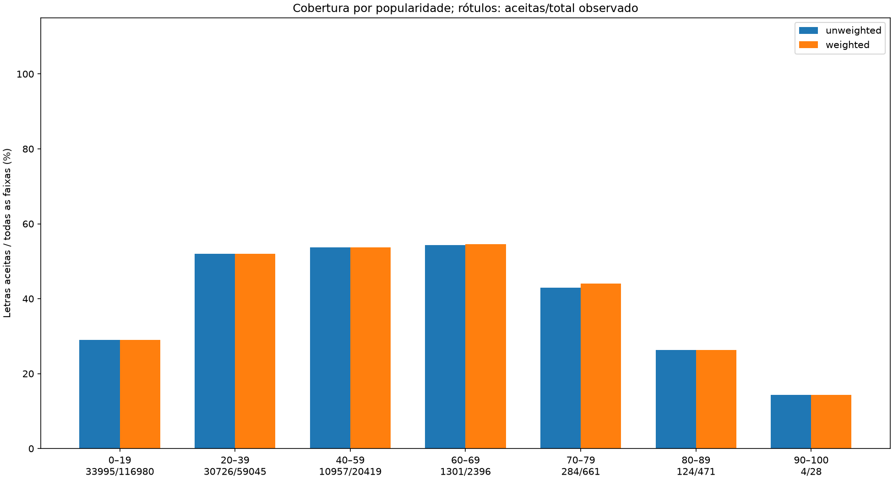
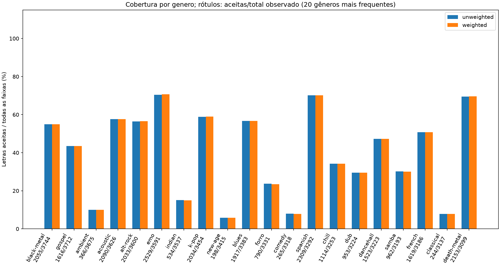
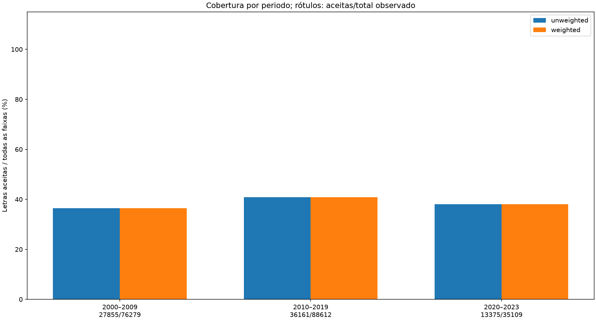

# Busca LRCLIB local da amostra Spotify

Status: **completed**. 200,000 faixas preservadas; resultados automáticos aceitos pelo protocolo, sem validação humana individual.

Consultas distintas: 199,973; já tentadas: 199,973; faixas correspondentes já tentadas: 199,973.

## Status e denominadores

| scope | metric | value | denominator |
| --- | --- | --- | --- |
| unweighted | accepted_n | 77391 | 200000.0000 |
| unweighted | accepted_total | 77391.0000 | 200000.0000 |
| unweighted | accepted_rate | 0.3870 | 200000.0000 |
| unweighted | ambiguous_n | 25775 | 200000.0000 |
| unweighted | ambiguous_total | 25775.0000 | 200000.0000 |
| unweighted | ambiguous_rate | 0.1289 | 200000.0000 |
| unweighted | not_found_n | 88049 | 200000.0000 |
| unweighted | not_found_total | 88049.0000 | 200000.0000 |
| unweighted | not_found_rate | 0.4402 | 200000.0000 |
| unweighted | no_text_n | 10 | 200000.0000 |
| unweighted | no_text_total | 10.0000 | 200000.0000 |
| unweighted | no_text_rate | 0.0001 | 200000.0000 |
| unweighted | instrumental_n | 8748 | 200000.0000 |
| unweighted | instrumental_total | 8748.0000 | 200000.0000 |
| unweighted | instrumental_rate | 0.0437 | 200000.0000 |
| unweighted | insufficient_metadata_n | 27 | 200000.0000 |
| unweighted | insufficient_metadata_total | 27.0000 | 200000.0000 |
| unweighted | insufficient_metadata_rate | 0.0001 | 200000.0000 |
| unweighted | technical_error_n | 0 | 200000.0000 |
| unweighted | technical_error_total | 0.0000 | 200000.0000 |
| unweighted | technical_error_rate | 0.0000 | 200000.0000 |
| unweighted | pending_n | 0 | 200000.0000 |
| unweighted | pending_total | 0.0000 | 200000.0000 |
| unweighted | pending_rate | 0.0000 | 200000.0000 |
| weighted | accepted_n | 77391 | 1159764.0000 |
| weighted | accepted_total | 448496.2737 | 1159764.0000 |
| weighted | accepted_rate | 0.3867 | 1159764.0000 |
| weighted | ambiguous_n | 25775 | 1159764.0000 |
| weighted | ambiguous_total | 146802.8846 | 1159764.0000 |
| weighted | ambiguous_rate | 0.1266 | 1159764.0000 |
| weighted | not_found_n | 88049 | 1159764.0000 |
| weighted | not_found_total | 513498.6426 | 1159764.0000 |
| weighted | not_found_rate | 0.4428 | 1159764.0000 |
| weighted | no_text_n | 10 | 1159764.0000 |
| weighted | no_text_total | 58.1139 | 1159764.0000 |
| weighted | no_text_rate | 0.0001 | 1159764.0000 |
| weighted | instrumental_n | 8748 | 1159764.0000 |
| weighted | instrumental_total | 50750.5563 | 1159764.0000 |
| weighted | instrumental_rate | 0.0438 | 1159764.0000 |
| weighted | insufficient_metadata_n | 27 | 1159764.0000 |
| weighted | insufficient_metadata_total | 157.5290 | 1159764.0000 |
| weighted | insufficient_metadata_rate | 0.0001 | 1159764.0000 |
| weighted | technical_error_n | 0 | 1159764.0000 |
| weighted | technical_error_total | 0.0000 | 1159764.0000 |
| weighted | technical_error_rate | 0.0000 | 1159764.0000 |
| weighted | pending_n | 0 | 1159764.0000 |
| weighted | pending_total | 0.0000 | 1159764.0000 |
| weighted | pending_rate | 0.0000 | 1159764.0000 |

## Candidato, texto e aceite são eventos distintos

| scope | metric | value | denominator |
| --- | --- | --- | --- |
| unweighted | candidate_present_positive_n | 111924 | 200000.0000 |
| unweighted | candidate_present_unknown_n | 27 | 200000.0000 |
| unweighted | candidate_present_positive_total | 111924.0000 | 200000.0000 |
| unweighted | candidate_present_known_denominator | 199973.0000 | 200000.0000 |
| unweighted | candidate_present_rate_known | 0.5597 | 200000.0000 |
| unweighted | text_present_positive_n | 101684 | 200000.0000 |
| unweighted | text_present_unknown_n | 868 | 200000.0000 |
| unweighted | text_present_positive_total | 101684.0000 | 200000.0000 |
| unweighted | text_present_known_denominator | 199132.0000 | 200000.0000 |
| unweighted | text_present_rate_known | 0.5106 | 200000.0000 |
| unweighted | plain_present_positive_n | 101680 | 200000.0000 |
| unweighted | plain_present_unknown_n | 868 | 200000.0000 |
| unweighted | plain_present_positive_total | 101680.0000 | 200000.0000 |
| unweighted | plain_present_known_denominator | 199132.0000 | 200000.0000 |
| unweighted | plain_present_rate_known | 0.5106 | 200000.0000 |
| unweighted | synced_present_positive_n | 77759 | 200000.0000 |
| unweighted | synced_present_unknown_n | 868 | 200000.0000 |
| unweighted | synced_present_positive_total | 77759.0000 | 200000.0000 |
| unweighted | synced_present_known_denominator | 199132.0000 | 200000.0000 |
| unweighted | synced_present_rate_known | 0.3905 | 200000.0000 |
| weighted | candidate_present_positive_n | 111924 | 1159764.0000 |
| weighted | candidate_present_unknown_n | 27 | 1159764.0000 |
| weighted | candidate_present_positive_total | 646107.8284 | 1159764.0000 |
| weighted | candidate_present_known_denominator | 1159606.4710 | 1159764.0000 |
| weighted | candidate_present_rate_known | 0.5572 | 1159764.0000 |
| weighted | text_present_positive_n | 101684 | 1159764.0000 |
| weighted | text_present_unknown_n | 868 | 1159764.0000 |
| weighted | text_present_positive_total | 586864.4330 | 1159764.0000 |
| weighted | text_present_known_denominator | 1154920.5585 | 1159764.0000 |
| weighted | text_present_rate_known | 0.5081 | 1159764.0000 |
| weighted | plain_present_positive_n | 101680 | 1159764.0000 |
| weighted | plain_present_unknown_n | 868 | 1159764.0000 |
| weighted | plain_present_positive_total | 586841.0499 | 1159764.0000 |
| weighted | plain_present_known_denominator | 1154920.5585 | 1159764.0000 |
| weighted | plain_present_rate_known | 0.5081 | 1159764.0000 |
| weighted | synced_present_positive_n | 77759 | 1159764.0000 |
| weighted | synced_present_unknown_n | 868 | 1159764.0000 |
| weighted | synced_present_positive_total | 447502.5186 | 1159764.0000 |
| weighted | synced_present_known_denominator | 1154920.5585 | 1159764.0000 |
| weighted | synced_present_rate_known | 0.3875 | 1159764.0000 |

Valores desconhecidos em erros/pendências não são convertidos em ausência. Taxa de aceite usa todas as faixas; disponibilidade de candidato/texto usa também denominador conhecido explicitado no CSV.

## Alta popularidade: inclusão integral original

| scope | category | metric | value | denominator |
| --- | --- | --- | --- | --- |
| unweighted | 80–89 | accepted_n | 124 | 471.0000 |
| unweighted | 80–89 | accepted_rate | 0.2633 | 471.0000 |
| unweighted | 80–89 | ambiguous_n | 343 | 471.0000 |
| unweighted | 80–89 | ambiguous_rate | 0.7282 | 471.0000 |
| unweighted | 80–89 | not_found_n | 2 | 471.0000 |
| unweighted | 80–89 | not_found_rate | 0.0042 | 471.0000 |
| unweighted | 80–89 | no_text_n | 0 | 471.0000 |
| unweighted | 80–89 | no_text_rate | 0.0000 | 471.0000 |
| unweighted | 80–89 | instrumental_n | 2 | 471.0000 |
| unweighted | 80–89 | instrumental_rate | 0.0042 | 471.0000 |
| unweighted | 80–89 | insufficient_metadata_n | 0 | 471.0000 |
| unweighted | 80–89 | insufficient_metadata_rate | 0.0000 | 471.0000 |
| unweighted | 80–89 | technical_error_n | 0 | 471.0000 |
| unweighted | 80–89 | technical_error_rate | 0.0000 | 471.0000 |
| unweighted | 80–89 | pending_n | 0 | 471.0000 |
| unweighted | 80–89 | pending_rate | 0.0000 | 471.0000 |
| unweighted | 90–100 | accepted_n | 4 | 28.0000 |
| unweighted | 90–100 | accepted_rate | 0.1429 | 28.0000 |
| unweighted | 90–100 | ambiguous_n | 24 | 28.0000 |
| unweighted | 90–100 | ambiguous_rate | 0.8571 | 28.0000 |
| unweighted | 90–100 | not_found_n | 0 | 28.0000 |
| unweighted | 90–100 | not_found_rate | 0.0000 | 28.0000 |
| unweighted | 90–100 | no_text_n | 0 | 28.0000 |
| unweighted | 90–100 | no_text_rate | 0.0000 | 28.0000 |
| unweighted | 90–100 | instrumental_n | 0 | 28.0000 |
| unweighted | 90–100 | instrumental_rate | 0.0000 | 28.0000 |
| unweighted | 90–100 | insufficient_metadata_n | 0 | 28.0000 |
| unweighted | 90–100 | insufficient_metadata_rate | 0.0000 | 28.0000 |
| unweighted | 90–100 | technical_error_n | 0 | 28.0000 |
| unweighted | 90–100 | technical_error_rate | 0.0000 | 28.0000 |
| unweighted | 90–100 | pending_n | 0 | 28.0000 |
| unweighted | 90–100 | pending_rate | 0.0000 | 28.0000 |
| weighted | 80–89 | accepted_n | 124 | 471.0000 |
| weighted | 80–89 | accepted_rate | 0.2633 | 471.0000 |
| weighted | 80–89 | ambiguous_n | 343 | 471.0000 |
| weighted | 80–89 | ambiguous_rate | 0.7282 | 471.0000 |
| weighted | 80–89 | not_found_n | 2 | 471.0000 |
| weighted | 80–89 | not_found_rate | 0.0042 | 471.0000 |
| weighted | 80–89 | no_text_n | 0 | 471.0000 |
| weighted | 80–89 | no_text_rate | 0.0000 | 471.0000 |
| weighted | 80–89 | instrumental_n | 2 | 471.0000 |
| weighted | 80–89 | instrumental_rate | 0.0042 | 471.0000 |
| weighted | 80–89 | insufficient_metadata_n | 0 | 471.0000 |
| weighted | 80–89 | insufficient_metadata_rate | 0.0000 | 471.0000 |
| weighted | 80–89 | technical_error_n | 0 | 471.0000 |
| weighted | 80–89 | technical_error_rate | 0.0000 | 471.0000 |
| weighted | 80–89 | pending_n | 0 | 471.0000 |
| weighted | 80–89 | pending_rate | 0.0000 | 471.0000 |
| weighted | 90–100 | accepted_n | 4 | 28.0000 |
| weighted | 90–100 | accepted_rate | 0.1429 | 28.0000 |
| weighted | 90–100 | ambiguous_n | 24 | 28.0000 |
| weighted | 90–100 | ambiguous_rate | 0.8571 | 28.0000 |
| weighted | 90–100 | not_found_n | 0 | 28.0000 |
| weighted | 90–100 | not_found_rate | 0.0000 | 28.0000 |
| weighted | 90–100 | no_text_n | 0 | 28.0000 |
| weighted | 90–100 | no_text_rate | 0.0000 | 28.0000 |
| weighted | 90–100 | instrumental_n | 0 | 28.0000 |
| weighted | 90–100 | instrumental_rate | 0.0000 | 28.0000 |
| weighted | 90–100 | insufficient_metadata_n | 0 | 28.0000 |
| weighted | 90–100 | insufficient_metadata_rate | 0.0000 | 28.0000 |
| weighted | 90–100 | technical_error_n | 0 | 28.0000 |
| weighted | 90–100 | technical_error_rate | 0.0000 | 28.0000 |
| weighted | 90–100 | pending_n | 0 | 28.0000 |
| weighted | 90–100 | pending_rate | 0.0000 | 28.0000 |

## Diferenças descritivas: aceitas menos não aceitas

| scope | variable | metric | value |
| --- | --- | --- | --- |
| unweighted | popularity | mean_difference | 8.6681 |
| unweighted | popularity | standardized_mean_difference | 0.5530 |
| unweighted | danceability | mean_difference | 0.0053 |
| unweighted | danceability | standardized_mean_difference | 0.0289 |
| unweighted | energy | mean_difference | 0.0891 |
| unweighted | energy | standardized_mean_difference | 0.3424 |
| unweighted | key | mean_difference | 0.0113 |
| unweighted | key | standardized_mean_difference | 0.0032 |
| unweighted | loudness | mean_difference | 3.0091 |
| unweighted | loudness | standardized_mean_difference | 0.5830 |
| unweighted | mode | mean_difference | 0.0195 |
| unweighted | mode | standardized_mean_difference | 0.0407 |
| unweighted | speechiness | mean_difference | -0.0124 |
| unweighted | speechiness | standardized_mean_difference | -0.1028 |
| unweighted | acousticness | mean_difference | -0.1198 |
| unweighted | acousticness | standardized_mean_difference | -0.3513 |
| unweighted | instrumentalness | mean_difference | -0.2362 |
| unweighted | instrumentalness | standardized_mean_difference | -0.7180 |
| unweighted | liveness | mean_difference | 0.0018 |
| unweighted | liveness | standardized_mean_difference | 0.0088 |
| unweighted | valence | mean_difference | 0.0284 |
| unweighted | valence | standardized_mean_difference | 0.1072 |
| unweighted | tempo | mean_difference | 3.2801 |
| unweighted | tempo | standardized_mean_difference | 0.1107 |
| unweighted | duration_ms | mean_difference | -23677.1287 |
| unweighted | duration_ms | standardized_mean_difference | -0.1652 |
| unweighted | time_signature | mean_difference | 0.0437 |
| unweighted | time_signature | standardized_mean_difference | 0.0967 |
| weighted | popularity | mean_difference | 8.7479 |
| weighted | popularity | standardized_mean_difference | 0.5727 |
| weighted | danceability | mean_difference | 0.0052 |
| weighted | danceability | standardized_mean_difference | 0.0285 |
| weighted | energy | mean_difference | 0.0896 |
| weighted | energy | standardized_mean_difference | 0.3438 |
| weighted | key | mean_difference | 0.0106 |
| weighted | key | standardized_mean_difference | 0.0030 |
| weighted | loudness | mean_difference | 3.0215 |
| weighted | loudness | standardized_mean_difference | 0.5851 |
| weighted | mode | mean_difference | 0.0196 |
| weighted | mode | standardized_mean_difference | 0.0408 |
| weighted | speechiness | mean_difference | -0.0125 |
| weighted | speechiness | standardized_mean_difference | -0.1036 |
| weighted | acousticness | mean_difference | -0.1206 |
| weighted | acousticness | standardized_mean_difference | -0.3533 |
| weighted | instrumentalness | mean_difference | -0.2372 |
| weighted | instrumentalness | standardized_mean_difference | -0.7202 |
| weighted | liveness | mean_difference | 0.0017 |
| weighted | liveness | standardized_mean_difference | 0.0086 |
| weighted | valence | mean_difference | 0.0284 |
| weighted | valence | standardized_mean_difference | 0.1071 |
| weighted | tempo | mean_difference | 3.2796 |
| weighted | tempo | standardized_mean_difference | 0.1107 |
| weighted | duration_ms | mean_difference | -23781.0779 |
| weighted | duration_ms | standardized_mean_difference | -0.1655 |
| weighted | time_signature | mean_difference | 0.0439 |
| weighted | time_signature | standardized_mean_difference | 0.0969 |

CSV contém médias, mediana/P50 e quantis, 13 atributos (incluindo duração), ausências/domínios, gênero/ano/período, créditos e concentração em amostra completa, aceitas, não aceitas e cada status, sem/com pesos. Contagens distintas de créditos são observadas, não estimativas por soma de pesos.

## Execuções e retomadas

| started_at | new_queries | new_tracks | reused_queries | reused_tracks | errors_this_run | elapsed_seconds | stop_reason |
| --- | --- | --- | --- | --- | --- | --- | --- |
| 2026-10-31T20:11:08.318423+00:00 | 199973 | 199973 | 0 | 0 | 0 | 1691.3110 | — |

Tempo acumulado de consultas: 1691.31 segundos; não inclui indexação nem geração dos relatórios. Reutilização refere-se a consultas concluídas deste workspace; importações de caches antigos: zero.

## Limitações

Taxa ponderada estima cobertura no catálogo sob este protocolo e snapshot. Pesos originais não corrigem automaticamente seleção por disponibilidade/aceitação de letras. Sem letra não implica instrumental. Nenhuma substituição, recalibração, filtro de idioma/gênero, split ou modelo foi aplicado. O teste V0.6 já aberto continua exposto.

Diferenças de proporções e médias padronizadas são descritivas; sem p-valores como selo de representatividade. Resultados incompletos misturam pendências operacionais à não aceitação e devem ser interpretados como provisórios. Idioma estimado por langid quando disponível; score não é probabilidade calibrada e não decide aceite.

## Gráficos

Tempo total desta invocação, incluindo preparação/indexação quando necessária e relatórios: 3676.40 segundos.
