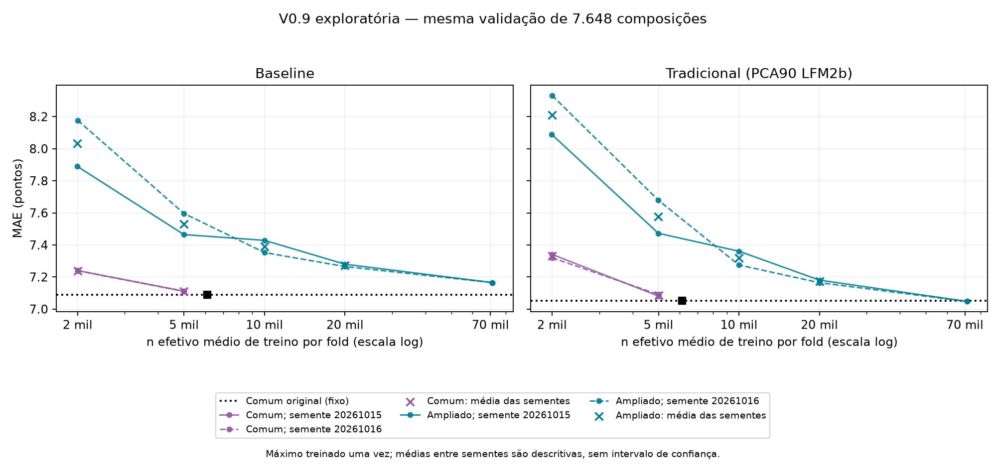
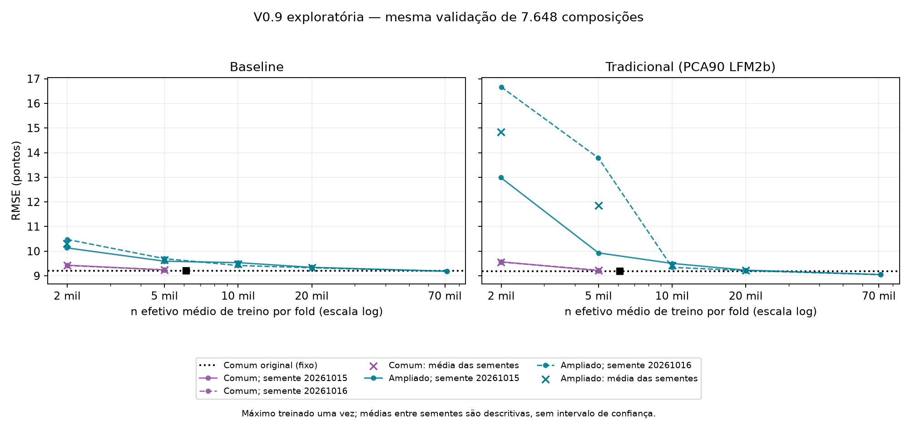
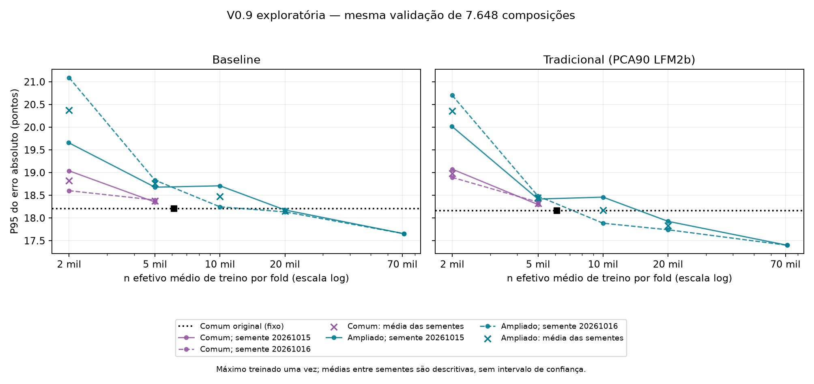
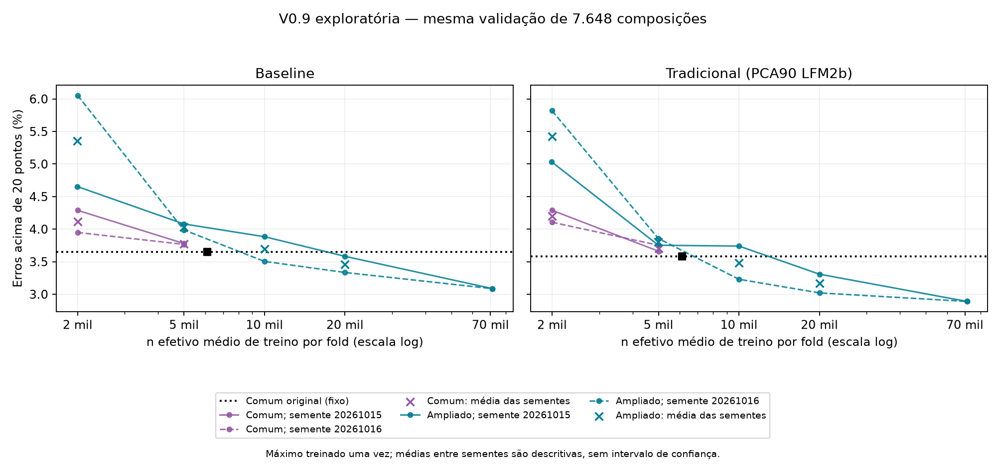

# Experimento de ampliação do treinamento — V0.9

## Síntese conclusiva da execução

1. **Disponibilidade:** 83.817 faixas do desenvolvimento original; 83.559 representantes por composição operacional, em 10.301 grupos de artista. São 75.911 composições adicionais frente às 7.648 comuns. Oito faixas sem chave permanecem na matriz por faixa; 250 versões adicionais foram colapsadas somente na visão por composição. Cada treino máximo contém 71.052–71.519 composições após exclusões de grupos, não as 83.559 simultaneamente.
2. **Popularidade alta adicional:** 1.538 composições com alvo ≥60, 300 com ≥70 e 45 com ≥80, antes das exclusões específicas de cada fold. Os limiares se sobrepõem. A validação não ganhou casos: continua com 125/27/1 observações nesses limiares.
3. **Mais dados versus referência comum:** Baseline MAE 7,088595 → 7,165120 (+1,08%), RMSE 9,209508 → 9,184520 e erros >20 de 279 → 236. Tradicional MAE 7,052903 → 7,047780 (−0,073%, praticamente estável), RMSE 9,181208 → 9,048948 e erros >20 de 274 → 221. P95 diminui em ambos. A mediana do erro aumenta em ambos: a melhora da cauda não é melhora uniforme da distribuição. No Tradicional, o MAE melhora em apenas 2/5 folds frente à referência comum; RMSE e frequência >20 melhoram nos cinco. No Baseline, MAE piora nos cinco folds.
4. **Forma das curvas:** as duas trajetórias ampliadas ainda reduzem MAE de aproximadamente 20 mil para o máximo. A média descritiva do MAE entre sementes passa de 7,272489 para 7,165120 no Baseline e de 7,172603 para 7,047780 no Tradicional. Os ganhos por observação adicional são menores nos treinos grandes; não há evidência suficiente para declarar um platô definitivo nem extrapolar a curva além do observado. Nos controles de aproximadamente 2 mil e 5 mil, o universo ampliado tem MAE maior que o comum em ambos os blocos e sementes: tamanho sozinho não explica a diferença de desempenho.
5. **Incremento Tradicional, com linhas idênticas:** no máximo ampliado, MAE 7,165120 → 7,047780, diferença −0,117340 ponto (−1,64%); RMSE 9,184520 → 9,048948; erros >20 de 236 → 221. O MAE Tradicional é menor nos cinco folds desse contraste. É um incremento descritivo modesto, sem teste de significância/intervalo de confiança nem confirmação independente. Não confundir esse contraste com o efeito de ampliar o treino.
6. **Limites que permanecem:** identidade de composição operacional, múltiplas versões, matching e descritores potencialmente de outra versão; year e genre com semântica limitada da fonte; oito descritores estruturais ausentes em 31.534 faixas; hashes conhecidos somente para uma minoria dos representantes. Não há comprovação de ausência de duplicação textual onde falta hash. A amostra de validação continua condicionada à disponibilidade de letras.
7. **Direção sugerida, não executada:** aproveitar os dados existentes faz sentido para cobertura e redução de erros grandes, mas não sustenta prometer grande melhora de MAE pela simples ampliação com essa representação. Priorizar auditoria de identidade/versões e estabilidade das representações, mantendo comparação de tamanhos controlada. Uma nova família de modelos exigiria hipótese e protocolo próprios; a V0.9 não demonstra que ela seja necessária ou superior. Nenhum modelo final ou demonstrador foi substituído.

### Instabilidade nos treinos pequenos — preservada, não corrigida pelo resultado

O Tradicional ampliado de aproximadamente 2 mil observações apresentou RMSE 12,990737 e 16,667383 nas duas sementes. Nos respectivos conjuntos OOF, o maior erro quadrático representa 37,14% e 58,53% da soma dos erros quadráticos. As previsões brutas chegam a 722,330624 e −1.085,105664 pontos, respectivamente; em aproximadamente 5 mil, também há extremos (263,397717 e −823,030852). Essas previsões e todas as observações foram mantidas, sem clipping, exclusão ou nova escolha de hiperparâmetros.

Inspeção pós-ajuste, somente dos artefatos privados V0.9, encontrou no fold 1 da condição ampliada 2 mil/semente 20261016 um máximo absoluto de **4.227,203050** na variável `lfm_affective_liwc_filler` após padronização com estatísticas do treino e antes da PCA. Trata-se de evidência de extrapolação nessa representação nos treinos pequenos, não de semântica nova para a variável nem de prova de erro no registro. As previsões extremas foram reproduzidas pelos pipelines persistidos com diferença zero; não foi encontrado desalinhamento de linhas ou uso de alvo no input. Uma análise causal da contribuição desse descritor ou uma nova transformação não foi executada.

### Verificações concluídas

**50 testes passaram**; Ruff e formatação dos quatro arquivos Python novos passaram, com código 0. Preparação, benchmark, execução de 140 ajustes e verificação terminaram com código 0; nenhum warning de ajuste. Foram reproduzidos 140 pipelines e 28 vetores OOF completos, com diferença máxima zero e tolerância absoluta 1e-10. Os 372 hashes anteriores e os metadados de 18.349 arquivos de dados permaneceram iguais; HEAD/stage também.

O Ruff global retornou código 1 exclusivamente por `B018` em `exp_base.py:8` (expressão `head` sem efeito), arquivo pessoal preexistente e preservado. Não é falha dos arquivos V0.9. A inspeção visual dos quatro gráficos foi concluída; uma etapa separada de apresentação removeu sobreposição dos rótulos sem alterar o CSV de métricas ou o código científico selado. Comandos completos e códigos reais estão no run summary e em `docs/base_ampliada_v0_9.md`.

Exploratório, sem confirmação independente. Mesmas 7.648 observações e cinco folds externos V0.5/V0.8 para todas as condições. Nenhum alvo do holdout original foi carregado. Modelos, splits, dados e resultados anteriores preservados; sem coleta, novos embeddings, interface, commit ou push.

## Desenho e referência correta

SHA-256 do protocolo antes dos ajustes: `adf5dec4a1394c44bd4b19966f7173acef54439c9cd18a24874ed4602907fc37`. Dois Elastic Net com alpha=0.003/l1_ratio=0.95, fixados a partir dos ajustes finais V0.5. Sem tuning. A referência 'common original' foi **reajustada com essa configuração fixa**, portanto não deve ser confundida com a OOF V0.5 produzida por tuning interno por fold. Todo pré-processamento e coeficientes foram reaprendidos em cada treino; PCA90 somente no bloco LFM2b.

Sementes dos subconjuntos: 20261015 e 20261016. Grupos completos, ordenados por hash sem alvo ou resultados. Cada sequência é aninhada; máximo contém o treino comum original e é ajustado uma só vez. Comum com aproximadamente 2.000/5.000 oferece controle de tamanho versus ampliado; diferenças de composição e contagens efetivas não desaparecem. Não se escolheu a melhor semente.

## Cobertura disponível

| Etapa | n | Composições | Artistas | ≥60 | ≥70 | ≥80 |
| --- | --- | --- | --- | --- | --- | --- |
| integrated_development_tracks | 83817 | 83559 | 10301 | 1667 | 327 | 46 |
| eligible_development_compositions | 83559 | 83559 | 10301 | 1663 | 327 | 46 |
| v04_main_selected | 10500 | 10500 | 4481 | 196 | 40 | 6 |
| v04_reserve_available | 1500 | 1500 | 1225 | 32 | 7 | 2 |
| v04_actually_queried | 11250 | 11250 | 4643 | 212 | 45 | 7 |
| v04_lyrics_accepted | 7648 | 7648 | 3749 | 125 | 27 | 1 |
| common_v05 | 7648 | 7648 | 3749 | 125 | 27 | 1 |
| additional_compositions | 75911 | 75911 | 9994 | 1538 | 300 | 45 |

## Máximo ampliado versus treino comum original

| Bloco | ΔMAE | ΔMAE % | ΔRMSE | ΔP95 | Δ >20 (n) |
| --- | --- | --- | --- | --- | --- |
| baseline | 0.07652 | 1.07955 | -0.02499 | -0.55363 | -43 |
| traditional | -0.00512 | -0.07264 | -0.13226 | -0.76221 | -53 |

Deltas negativos de erro indicam melhora. Ganho de quantidade/composição não pode ser atribuído às letras. Os próximos resultados mostram todas as condições, sem exclusão retrospectiva.

## Curvas OOF completas

n de treino é a média efetiva entre os cinco folds (mínimo/máximo no CSV); não é soma de amostras independentes. OOF n=7.648 em cada linha. Proporções >20 abaixo são percentuais; no CSV são frações. Previsões brutas, sem clipping ou calibração.

| Condição | Bloco | n treino médio | MAE | RMSE | R² | Mediana | P90 | P95 | >20 % | n >20 |
| --- | --- | --- | --- | --- | --- | --- | --- | --- | --- | --- |
| common__original__seedshared | baseline | 6118.40000 | 7.08860 | 9.20951 | 0.53019 | 5.86595 | 14.29754 | 18.20749 | 3.64801 | 279 |
| common__original__seedshared | traditional | 6118.40000 | 7.05290 | 9.18121 | 0.53308 | 5.79438 | 14.46417 | 18.16258 | 3.58264 | 274 |
| expanded__maximum__seedshared | baseline | 71215.20000 | 7.16512 | 9.18452 | 0.53274 | 5.99841 | 14.23230 | 17.65386 | 3.08577 | 236 |
| expanded__maximum__seedshared | traditional | 71215.20000 | 7.04778 | 9.04895 | 0.54643 | 5.88977 | 14.18037 | 17.40037 | 2.88964 | 221 |
| common__2000__seed20261015 | baseline | 1999.60000 | 7.24017 | 9.43174 | 0.50725 | 5.90160 | 14.81866 | 19.03877 | 4.28870 | 328 |
| common__2000__seed20261015 | traditional | 1999.60000 | 7.34118 | 9.56815 | 0.49289 | 5.98592 | 15.05038 | 19.07590 | 4.28870 | 328 |
| common__5000__seed20261015 | baseline | 5000.20000 | 7.11133 | 9.23876 | 0.52720 | 5.81482 | 14.41455 | 18.35051 | 3.77877 | 289 |
| common__5000__seed20261015 | traditional | 5000.20000 | 7.08084 | 9.20850 | 0.53030 | 5.88980 | 14.52555 | 18.29490 | 3.66109 | 280 |
| common__2000__seed20261016 | baseline | 1998.40000 | 7.23947 | 9.41826 | 0.50865 | 5.90004 | 14.71153 | 18.60143 | 3.94874 | 302 |
| common__2000__seed20261016 | traditional | 1998.40000 | 7.32028 | 9.55566 | 0.49421 | 5.99184 | 14.96519 | 18.89459 | 4.10565 | 314 |
| common__5000__seed20261016 | baseline | 4999.80000 | 7.11062 | 9.24216 | 0.52686 | 5.81230 | 14.46837 | 18.39589 | 3.76569 | 288 |
| common__5000__seed20261016 | traditional | 4999.80000 | 7.09110 | 9.22872 | 0.52823 | 5.81671 | 14.53599 | 18.34992 | 3.75262 | 287 |
| expanded__2000__seed20261015 | baseline | 1991.40000 | 7.89044 | 10.13386 | 0.43115 | 6.62911 | 15.96189 | 19.65750 | 4.65481 | 356 |
| expanded__2000__seed20261015 | traditional | 1991.40000 | 8.09009 | 12.99074 | 0.06521 | 6.67690 | 16.29220 | 20.02085 | 5.03400 | 385 |
| expanded__5000__seed20261015 | baseline | 4996.20000 | 7.46454 | 9.59322 | 0.49023 | 6.25569 | 15.02501 | 18.67833 | 4.07950 | 312 |
| expanded__5000__seed20261015 | traditional | 4996.20000 | 7.47237 | 9.93007 | 0.45380 | 6.24194 | 14.97578 | 18.41760 | 3.75262 | 287 |
| expanded__10000__seed20261015 | baseline | 10003.60000 | 7.42860 | 9.53350 | 0.49656 | 6.15109 | 15.02880 | 18.70888 | 3.88337 | 297 |
| expanded__10000__seed20261015 | traditional | 10003.60000 | 7.36077 | 9.50313 | 0.49976 | 6.07967 | 14.97447 | 18.45940 | 3.73954 | 286 |
| expanded__20000__seed20261015 | baseline | 19993.80000 | 7.27974 | 9.34399 | 0.51637 | 6.05016 | 14.68978 | 18.17750 | 3.58264 | 274 |
| expanded__20000__seed20261015 | traditional | 19993.80000 | 7.18056 | 9.22885 | 0.52822 | 5.93448 | 14.52288 | 17.92676 | 3.30805 | 253 |
| expanded__2000__seed20261016 | baseline | 1999.80000 | 8.17748 | 10.47675 | 0.39201 | 6.71928 | 16.92170 | 21.09191 | 6.05387 | 463 |
| expanded__2000__seed20261016 | traditional | 1999.80000 | 8.33234 | 16.66738 | -0.53879 | 6.62874 | 16.79353 | 20.70161 | 5.81851 | 445 |
| expanded__5000__seed20261016 | baseline | 4990.80000 | 7.59687 | 9.69712 | 0.47913 | 6.38494 | 15.28319 | 18.83510 | 3.98797 | 305 |
| expanded__5000__seed20261016 | traditional | 4990.80000 | 7.67955 | 13.78680 | -0.05287 | 6.32457 | 15.27096 | 18.48375 | 3.85722 | 295 |
| expanded__10000__seed20261016 | baseline | 9999.40000 | 7.35240 | 9.41811 | 0.50867 | 6.17030 | 14.59439 | 18.24601 | 3.50418 | 268 |
| expanded__10000__seed20261016 | traditional | 9999.40000 | 7.27484 | 9.34388 | 0.51638 | 6.08274 | 14.58772 | 17.88520 | 3.22960 | 247 |
| expanded__20000__seed20261016 | baseline | 20001.20000 | 7.26524 | 9.32533 | 0.51830 | 6.08367 | 14.49865 | 18.13550 | 3.33421 | 255 |
| expanded__20000__seed20261016 | traditional | 20001.20000 | 7.16464 | 9.20870 | 0.53028 | 5.98400 | 14.35517 | 17.74088 | 3.02040 | 231 |

## Controles de tamanho aproximado

| Condição ampliada | Bloco | n ampliado | n comum | ΔMAE | ΔRMSE | ΔP95 |
| --- | --- | --- | --- | --- | --- | --- |
| expanded__2000__seed20261015 | baseline | 1991.40000 | 1999.60000 | 0.65027 | 0.70212 | 0.61873 |
| expanded__2000__seed20261015 | traditional | 1991.40000 | 1999.60000 | 0.74892 | 3.42259 | 0.94495 |
| expanded__5000__seed20261015 | baseline | 4996.20000 | 5000.20000 | 0.35321 | 0.35447 | 0.32782 |
| expanded__5000__seed20261015 | traditional | 4996.20000 | 5000.20000 | 0.39154 | 0.72156 | 0.12270 |
| expanded__2000__seed20261016 | baseline | 1999.80000 | 1998.40000 | 0.93801 | 1.05848 | 2.49047 |
| expanded__2000__seed20261016 | traditional | 1999.80000 | 1998.40000 | 1.01206 | 7.11172 | 1.80702 |
| expanded__5000__seed20261016 | baseline | 4990.80000 | 4999.80000 | 0.48625 | 0.45496 | 0.43922 |
| expanded__5000__seed20261016 | traditional | 4990.80000 | 4999.80000 | 0.58846 | 4.55808 | 0.13383 |

Esses controles ajudam a distinguir quantidade e composição; não demonstram efeito causal e não tornam os universos intercambiáveis.

## Tradicional versus Baseline com as mesmas linhas

| Condição | ΔMAE T−B | ΔMAE % | ΔRMSE | ΔP95 | Δ >20 (n) |
| --- | --- | --- | --- | --- | --- |
| common__original__seedshared | -0.03569 | -0.50351 | -0.02830 | -0.04491 | -5 |
| expanded__maximum__seedshared | -0.11734 | -1.63766 | -0.13557 | -0.25350 | -15 |
| common__2000__seed20261015 | 0.10101 | 1.39507 | 0.13640 | 0.03713 | 0 |
| common__5000__seed20261015 | -0.03049 | -0.42874 | -0.03025 | -0.05561 | -9 |
| common__2000__seed20261016 | 0.08081 | 1.11628 | 0.13739 | 0.29316 | 12 |
| common__5000__seed20261016 | -0.01953 | -0.27463 | -0.01343 | -0.04597 | -1 |
| expanded__2000__seed20261015 | 0.19965 | 2.53032 | 2.85687 | 0.36335 | 29 |
| expanded__5000__seed20261015 | 0.00783 | 0.10494 | 0.33684 | -0.26074 | -25 |
| expanded__10000__seed20261015 | -0.06783 | -0.91312 | -0.03038 | -0.24947 | -11 |
| expanded__20000__seed20261015 | -0.09918 | -1.36241 | -0.11514 | -0.25074 | -21 |
| expanded__2000__seed20261016 | 0.15487 | 1.89381 | 6.19064 | -0.39029 | -18 |
| expanded__5000__seed20261016 | 0.08268 | 1.08838 | 4.08968 | -0.35135 | -10 |
| expanded__10000__seed20261016 | -0.07756 | -1.05486 | -0.07423 | -0.36081 | -21 |
| expanded__20000__seed20261016 | -0.10059 | -1.38456 | -0.11662 | -0.39462 | -24 |

## Gráficos agregados

Linhas mostram as duas sementes e cruzes suas médias descritivas. O máximo compartilhado aparece nas duas trajetórias, mas foi treinado uma única vez. Não há IC a partir dessas duas sementes.

## Faixas do alvo e resultados por fold

Todas as métricas por fold e por faixa estão em `curvas_aprendizagem_v0_9.csv`. Faixas com n<30 são marcadas; R² não é calculado nos estratos. A tabela abaixo compara as referências e os máximos; os denominadores permanecem exatamente iguais, pois não muda a validação.

| Faixa | Condição | Bloco | n | n<30 | MAE | RMSE | P95 | >20 % |
| --- | --- | --- | --- | --- | --- | --- | --- | --- |
| [0,10) | original | baseline | 729 | False | 9.23606 | 11.25482 | 18.75963 | 3.70370 |
| [10,20) | original | baseline | 1949 | False | 6.54431 | 7.81528 | 14.06712 | 0.25654 |
| [20,30) | original | baseline | 2187 | False | 5.10469 | 6.32215 | 12.20330 | 0.04572 |
| [30,40) | original | baseline | 1590 | False | 6.00795 | 7.70851 | 15.61691 | 1.44654 |
| [40,50) | original | baseline | 749 | False | 8.98744 | 11.34262 | 22.34938 | 9.34579 |
| [50,60) | original | baseline | 319 | False | 14.59336 | 16.81313 | 28.60963 | 26.33229 |
| [60,70) | original | baseline | 98 | False | 18.84046 | 20.99904 | 32.45344 | 48.97959 |
| [70,80) | original | baseline | 26 | True | 28.22558 | 30.30354 | 44.90646 | 76.92308 |
| [80,90) | original | baseline | 1 | True | 41.93923 | 41.93923 | 41.93923 | 100.00000 |
| [90,100] | original | baseline | 0 | True | — | — | — | — |
| [0,10) | original | traditional | 729 | False | 8.83655 | 10.92651 | 18.64233 | 3.15501 |
| [10,20) | original | traditional | 1949 | False | 6.45968 | 7.84416 | 14.61428 | 0.56439 |
| [20,30) | original | traditional | 2187 | False | 5.26183 | 6.50116 | 12.58610 | 0.04572 |
| [30,40) | original | traditional | 1590 | False | 6.06095 | 7.79492 | 16.02523 | 1.38365 |
| [40,50) | original | traditional | 749 | False | 8.90705 | 11.33505 | 22.33801 | 8.81175 |
| [50,60) | original | traditional | 319 | False | 14.07020 | 16.31957 | 26.83030 | 25.07837 |
| [60,70) | original | traditional | 98 | False | 18.67470 | 20.75976 | 31.12899 | 51.02041 |
| [70,80) | original | traditional | 26 | True | 28.16782 | 30.05591 | 43.42356 | 76.92308 |
| [80,90) | original | traditional | 1 | True | 42.05852 | 42.05852 | 42.05852 | 100.00000 |
| [90,100] | original | traditional | 0 | True | — | — | — | — |
| [0,10) | maximum | baseline | 729 | False | 9.41284 | 11.37033 | 18.47573 | 3.01783 |
| [10,20) | maximum | baseline | 1949 | False | 6.97654 | 8.25733 | 14.68211 | 0.05131 |
| [20,30) | maximum | baseline | 2187 | False | 5.39615 | 6.61583 | 12.50167 | 0.04572 |
| [30,40) | maximum | baseline | 1590 | False | 5.90306 | 7.50415 | 14.82450 | 0.88050 |
| [40,50) | maximum | baseline | 749 | False | 8.24518 | 10.65858 | 21.91599 | 8.14419 |
| [50,60) | maximum | baseline | 319 | False | 13.77937 | 15.97047 | 27.04465 | 22.25705 |
| [60,70) | maximum | baseline | 98 | False | 18.44448 | 20.43177 | 30.42855 | 44.89796 |
| [70,80) | maximum | baseline | 26 | True | 28.10385 | 30.09833 | 44.11074 | 80.76923 |
| [80,90) | maximum | baseline | 1 | True | 42.83056 | 42.83056 | 42.83056 | 100.00000 |
| [90,100] | maximum | baseline | 0 | True | — | — | — | — |
| [0,10) | maximum | traditional | 729 | False | 8.98767 | 11.01111 | 18.37803 | 2.88066 |
| [10,20) | maximum | traditional | 1949 | False | 6.75362 | 8.08187 | 14.60784 | 0.30785 |
| [20,30) | maximum | traditional | 2187 | False | 5.43825 | 6.67306 | 12.71361 | 0.09145 |
| [30,40) | maximum | traditional | 1590 | False | 5.94434 | 7.52834 | 15.00795 | 1.00629 |
| [40,50) | maximum | traditional | 749 | False | 8.13377 | 10.51490 | 20.98015 | 6.67557 |
| [50,60) | maximum | traditional | 319 | False | 13.16117 | 15.37875 | 26.12765 | 19.43574 |
| [60,70) | maximum | traditional | 98 | False | 18.14861 | 20.07000 | 29.35914 | 43.87755 |
| [70,80) | maximum | traditional | 26 | True | 27.98055 | 29.93556 | 44.59993 | 76.92308 |
| [80,90) | maximum | traditional | 1 | True | 44.97313 | 44.97313 | 44.97313 | 100.00000 |
| [90,100] | maximum | traditional | 0 | True | — | — | — | — |

## Interpretação e limites

Mais observações podem reduzir variância e melhorar suporte, mas as curvas variam também pela composição de artistas/faixas. Avaliar a sequência inteira, as duas sementes e erros de cauda; não declarar estabilização a partir de um único ponto nem promover candidato por uma semente favorável. Nenhuma das comparações é causal.

A validação comum continua condicionada à disponibilidade de letras e tem somente 27 casos ≥70, um deles ≥80; não representa o universo ampliado. Melhorar nela não prova generalização a toda a base. Matching, chaves operacionais, versões alternativas, descritores LFM de outra versão e semântica limitada de year/genre/flags permanecem. Alvo é popularidade registrada no snapshot da faixa, não sucesso futuro. Nenhuma nova família de modelo foi introduzida.

## Execução e verificações

Ajustes integrais: 140; tentativas de fit: 140; warnings: 0; configurações malsucedidas: 0. Benchmark adicional: dois ajustes. Tempo da execução integral: 0.84 minutos. Configuração, tempos por condição, dimensões PCA e warnings estão no JSON.

Preservados 372 hashes de artefatos anteriores e metadados tamanho/mtime_ns de 18349 arquivos de dados. Não confundir essas duas verificações. HEAD/stage inalterados, dados privados ignorados e nenhum dado/modelo privado rastreado. Alvos do holdout não foram carregados.

Verificação real: 140 pipelines recarregados; diferença máxima de previsão 0, atol=1e-10/rtol=0. Partições reconstruídas exatamente, zero sobreposição de grupos/hashes conhecidos, transformações train-only, input sem alvo e OOF completas/finitas.

CLI no ambiente existente: `python -m tcc_music_popularity.training_expansion_v090 prepare`, depois `benchmark`, `run` e `verify`. Os dois primeiros recusam sobrescrever selos/testes existentes; para retomar, usar `run` com o mesmo selo. Comandos exatos de testes/lint e códigos de saída ficam no run summary após a entrega. Dicionário das matrizes e proveniência: `base_analitica_ampliada_v0_9.md`; arquivos individuais permanecem privados.
