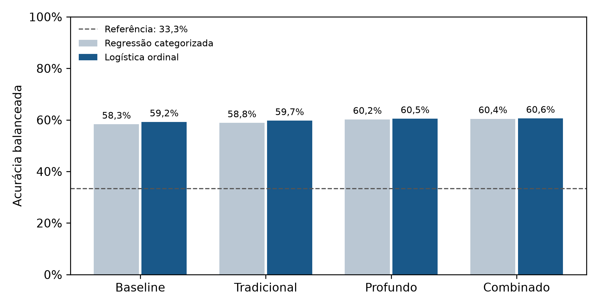
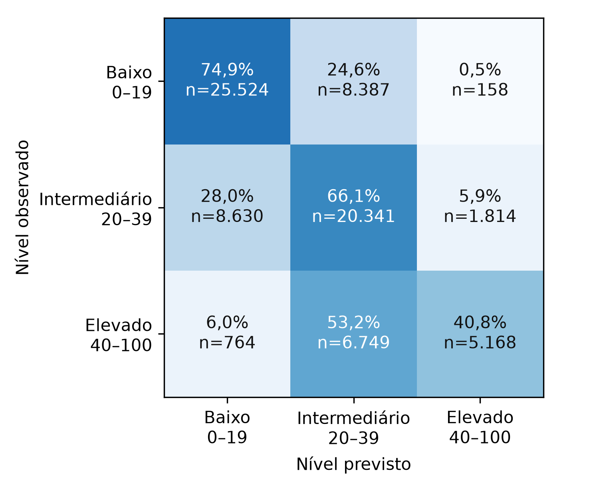
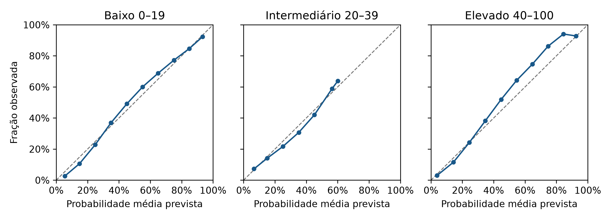

# Classificação ordinal: resultados e interpretação — 05/11/2026

Atualização de 06/11: a ação 36 indicada ao final deste registro foi concluída.
Resultados e compromisso entre regras em
[interpretação da sensibilidade](interpretacao_sensibilidade_decisao_ordinal_v1.md).
Os resultados principais abaixo foram preservados.

## Execução e integridade

Produção 34 concluída pelo pesquisador: vinte partes ordinais e cinco referências,
480 ajustes internos, 77.535 probabilidades por variante, zero pendências. Última
retomada: dezenove partes novas/uma reutilizada em 1.115,45 s; primeiro lote
105,42 s. Soma dos tempos registrados ~20min21s, excluindo preparação anterior
ao início dos temporizadores, não medição integral de relógio.

Conferidos hashes dos 25 modelos/Parquets, footers, assinatura, arquivo global
privado de 77.535 linhas (9.199.599 bytes) e checksums dos 480 ajustes internos.
Máximo interno 311 iterações, gradiente máximo 9,99e-7, zero avisos registrados.
Fonte, modelos da primeira regressão e PDFs preservados. Agente não repetiu treino
ou leitura integral de probabilidades individuais. Script 35 usa só agregados e
três modelos locais pequenos para inspecionar coeficientes de PCA, sem predict/fit.

## Comparação principal no domínio observado

Mesmas faixas, componentes e folds; cortes operacionais 20/40. Pesos iguais no
ajuste. Acurácia balanceada é média das três sensibilidades, não acurácia comum.

| Bloco | Acurácia balanceada | Acurácia | Macro-F1 | Log-loss | Brier multiclasse |
| --- | ---: | ---: | ---: | ---: | ---: |
| Baseline | 59,19% | 65,21% | 0,6114 | 0,7618 | 0,4628 |
| Tradicional | 59,69% | 65,45% | 0,6163 | 0,7562 | 0,4595 |
| Profundo | 60,45% | 65,71% | 0,6239 | 0,7462 | 0,4542 |
| Combinado | 60,58% | 65,82% | 0,6251 | 0,7451 | 0,4535 |
| Proporções do treino | 33,33% | 43,94% | 0,2035 | 1,0244 | 0,6226 |

Combinado−Baseline: +1,39 ponto percentual de acurácia balanceada; Combinado−Profundo:
+0,13 ponto. O incremento textual pontual permanece modesto; a mudança de resposta
não revelou uma separação grande entre representações. Combinado melhora Baseline
nos cinco folds (0,88 a 2,27 pontos), mas supera Profundo em três e perde em dois.
Folds não são réplicas independentes; esses sinais não estabelecem significância.

Sensibilidade com pesos originais preserva a ordenação: 59,33% / 59,82% / 60,57% /
60,69%. Probabilidades e treinos são os mesmos; não houve ajuste ponderado. Pesos
não corrigem automaticamente disponibilidade de letras ou cobertura do catálogo.

## Erros por classe

| Nível | Faixas | Sensibilidade Combinado | Precisão Combinado |
| --- | ---: | ---: | ---: |
| Baixo, 0–19 | 34.069 | 74,92% | 73,10% |
| Intermediário, 20–39 | 30.785 | 66,07% | 57,34% |
| Elevado operacional, 40–100 | 12.681 | 40,75% | 72,38% |

Entre as 12.681 elevadas, 5.168 foram previstas elevadas, 6.749 intermediárias e
764 baixas. Portanto, 59,25% não foram identificadas como elevadas; predominou a
confusão com intermediário. Os erros extremos 0↔2 totalizam 922, ou 1,19% das faixas.
O grupo elevado é operacional ≥40, não a cauda extrema ≥80 nem definição de hit.

Frente ao Baseline, sensibilidade elevada passa de 36,16% a 40,75% (+4,59 pontos),
com precisão de 73,56% para 72,38%. Há compromisso entre recuperar mais elevadas e
incluir falsas elevadas. A acurácia global isolada esconde essa assimetria.

## Comparação com a primeira regressão categorizada

Não comparar numericamente MAE 8,115 com acurácia: respostas/perdas são distintas.
Comparação possível usa a categorização anterior pelos mesmos limites/folds:

| Bloco | Regressão categorizada: acurácia balanceada | Ordinal | Diferença |
| --- | ---: | ---: | ---: |
| Baseline | 58,32% | 59,19% | +0,88 ponto |
| Tradicional | 58,84% | 59,69% | +0,85 ponto |
| Profundo | 60,18% | 60,45% | +0,27 ponto |
| Combinado | 60,42% | 60,58% | +0,16 ponto |

No Combinado, sensibilidade baixa sobe de 67,21% para 74,92%, intermediária cai
de 74,33% para 66,07% e elevada sobe de 39,73% para 40,75%. Alterou-se a distribuição
dos erros, com melhora pequena na média das três classes. A abordagem ordinal
fornece probabilidades, mas isso não demonstra superioridade prática ampla.
Procedimentos foram selecionados por critérios internos diferentes e a nova
etapa foi informada pelos resultados antigos; comparação exploratória.

## PCA e penalização

PCA95 escolhida em três das vinte partes: Profundo nos externos 0 e 3; Combinado
no externo 3. Baseline e Tradicional mantiveram numéricas originais nos cinco.
Nas três escolhas, nove componentes retêm cerca de 95,2% da variância das onze
numéricas padronizadas. As categorias, 21 descritores e 384 dimensões textuais
não entram nessa PCA. Não é uma redução de toda a matriz para nove colunas.

Nos modelos inspecionados, primeiro eixo combina energy/loudness em direção
oposta a acousticness; segundo associa valence/danceability em direção oposta a
instrumentalness. Terceiro varia entre folds, envolvendo year, duration_ms,
speechiness e liveness. São eixos descritivos de covariação, não grupos naturais
ou causas de popularidade. Sinais são arbitrários; arquivo de coeficientes orienta
apenas a apresentação sem modificar os modelos.

PCA não foi necessária para a maior parte das escolhas internas e não há aqui
evidência de ganho preditivo consistente. Seleção em três partes não é teste formal
de equivalência ou ausência de utilidade. Todas as vinte partes escolheram lambda
0,001, a menor da grade; limitação de resolução do procedimento. Isso não autoriza
expandir a grade depois de observar esses resultados e substituir a comparação.

## Probabilidades e limites

Desvio absoluto médio ponderado pelo tamanho dos dez intervalos fixos de calibração
no Combinado: 2,87 / 2,73 / 2,28 pontos percentuais nas classes baixa/intermediária/
elevada; Baseline: 4,00 / 3,72 / 2,74. Indicador depende dos intervalos e não é
intervalo de confiança ou prova de calibração. Referência constante pode ser bem
calibrada marginalmente e discriminar mal; não ordenar modelos só por esse desvio.

Na classe elevada, por exemplo, intervalo com probabilidade média 54,69% contém
64,28% de elevadas (n=2.545); há desvios sistemáticos visíveis. Isso não testa
formalmente chances proporcionais, cuja adequação continua hipótese/limitação.

Permanecem limites de inferência: domínio observado com letras aceitas, vínculos
sem padrão-ouro humano integral, identificação operacional de grupos, exposição
histórica, caráter exploratório, uma família ordinal e grade finita. Sem efeitos
causais, garantia para o Spotify inteiro ou IC integral do treinamento/CV.

## Ação delimitada seguinte

Sensibilidade D-027: manter probabilidades e avaliar uma regra fixa que atribui
importância igual às classes, usando apenas proporções dos respectivos treinos
externos. Justificativa é a baixa sensibilidade elevada e o compromisso da regra
argmax original. Não treinar, ajustar custos ao teste, substituir resultado principal
ou alegar validação de pipeline nova. Código 36 preparado/testado; execução real
manual pendente. Guias e protocolo distinguem regra de decisão de treino ponderado.
