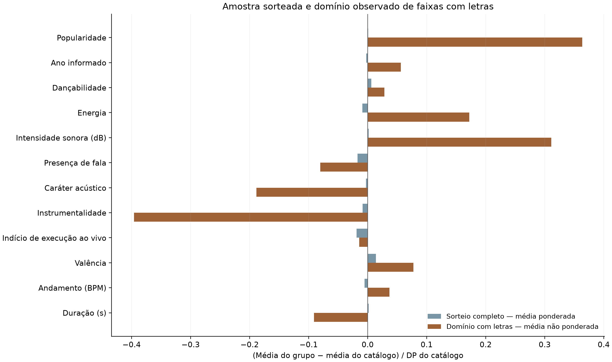

# Diagnóstico de chaves e seleção das faixas com letras

O diagnóstico 44 concluiu as 4.164 consultas em 137,64 segundos. As categorias
resumem os candidatos encontrados pelos métodos e limites especificados.

| Diagnóstico | Consultas |
|---|---:|
| Mesmo artista, outro título e duração próxima | 2.059 |
| Sem candidato pelos métodos aplicados | 1.676 |
| Mesmo título com outro artista | 410 |
| Variação na chave de artista | 13 |
| Outros candidatos de metadados | 6 |

Em 332 consultas houve truncamento pelo limite de registros. São 207 limites
na consulta por artista e 130 por título, com cinco consultas em comum. As
buscas textuais executadas terminaram dentro dos limites. Uma das consultas
sem candidato teve forma textual omitida pelo limite de termos. Os 13 casos
de artista têm 16 pares nas fichas privadas. A conferência pontual de campos
do LRCLIB encontrou pelo menos um registro com texto preenchido por consulta.
A validação de cada vínculo continua pendente.

O script 45 conferiu os campos originais do sorteio e resumiu os metadados
de 9.526 faixas, em uma leitura de colunas selecionadas do Parquet local de
1,56 MB. A comparação usa a média ponderada para o sorteio e a média simples
para descrever empiricamente as 3.647 aceitas. A tabela completa também contém
as médias ponderadas condicionais das aceitas.

| Média | Catálogo | Sorteio ponderado | Domínio aceito |
|---|---:|---:|---:|
| Popularidade | 18,383 | 18,397 | 24,156 |
| Energia | 0,640 | 0,637 | 0,686 |
| Instrumentalidade | 0,252 | 0,249 | 0,108 |
| Andamento (BPM) | 121,377 | 121,224 | 122,477 |

As maiores diferenças padronizadas nas aceitas ocorrem em instrumentalidade
(−0,396 DP do catálogo), popularidade (+0,363 DP) e intensidade sonora
(+0,311 DP). A recuperação tem cobertura seletiva. O sorteio fornece os pesos
de desenho e a disponibilidade observada de letras exige diagnóstico próprio.

O pesquisador escolheu ampliar a recuperação antes de definir a modelagem.
A revisão 46 trata as 831 ambiguidades por textos concorrentes. A inspeção
diagnóstica encontrou igualdade em cinco de doze casos após a uniformização
de caixa, espaços e tipografia vigente. A passagem produz um complemento
de letras e vínculos. A contagem dependerá da execução integral pelo pesquisador.
