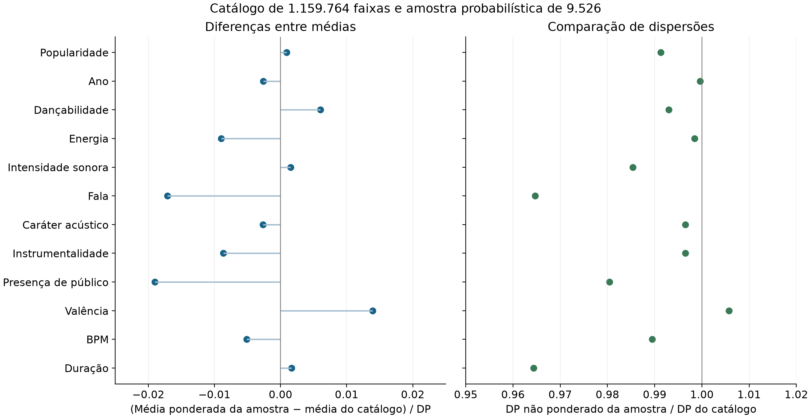
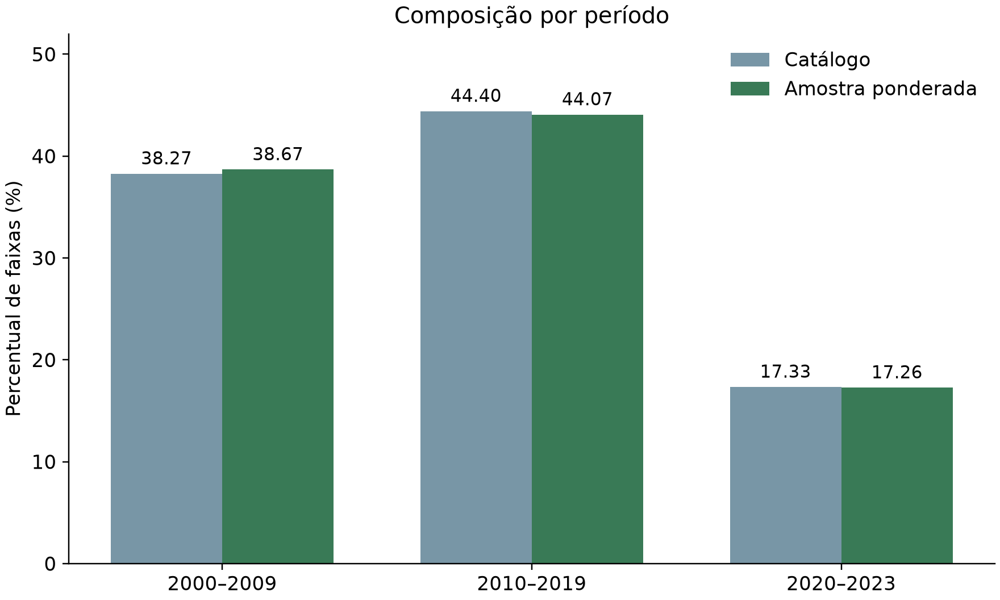

# Interpretação da nova amostra — sorteio concluído em 06/11/2026

O pesquisador executou o script 40: **9.526 faixas**, provenientes de 1.159.764,
nos 82 gêneros e semente 20261106. Resumo de conclusão, selos do plano,
comparativos e Parquet conferidos. A análise abaixo usa apenas tabelas agregadas;
nenhuma linha individual foi reprocessada pelo agente.

## Parecer

**Manter o sorteio e avançar para a recuperação de letras.** As características
avaliadas ficaram próximas às do cadastro. Isso decorre do desenho probabilístico
e de um resultado favorável deste sorteio, sem ajustar a seleção posteriormente.
Não é comprovação de igualdade de todas as distribuições ou de ausência de
seleção na futura disponibilidade de letras.

A maior diferença absoluta entre as doze médias ponderadas foi **0,01901 DP**,
em liveness; em seguida speechiness, −0,01710 DP, e valence, +0,01390 DP.
As doze diferenças ficaram dentro das respectivas margens de planejamento para
a família de médias. Não se realizou teste de igualdade com o próprio cadastro.

## Médias e dispersões

| Variável | Média do catálogo | Média ponderada da amostra | Diferença em DP |
|---|---:|---:|---:|
| Popularidade | 18.38312 | 18.39746 | +0.00090 |
| Ano | 2011.95500 | 2011.93715 | -0.00262 |
| Dançabilidade | 0.53744 | 0.53855 | +0.00603 |
| Energia | 0.63967 | 0.63724 | -0.00898 |
| Intensidade sonora | -8.98135 | -8.97273 | +0.00152 |
| Fala | 0.09281 | 0.09065 | -0.01710 |
| Caráter acústico | 0.32154 | 0.32058 | -0.00268 |
| Instrumentalidade | 0.25235 | 0.24920 | -0.00864 |
| Presença de público | 0.22302 | 0.21920 | -0.01901 |
| Valência | 0.45556 | 0.45930 | +0.01390 |
| BPM | 121.37714 | 121.22413 | -0.00514 |
| Duração | 249.56178 | 249.80931 | +0.00166 |

Duração expressa em segundos. BPM inclui zeros, como na população do desenho.
A popularidade mediana não ponderada foi 15 em ambos; seus quartis foram 5 e
29 em ambos, e P95 foi 48 na amostra e 49 no catálogo. A mediana de duração foi
225,689 s contra 225,744 s, e P95 451,720 s contra 448,000 s.

As razões entre DP amostral **não ponderado** e DP populacional variaram de
0,9644 (duração) a 1,0057 (valência). A dispersão de speechiness foi 0,9647 da
populacional. Essas pequenas diferenças, inclusive nas caudas, devem ser
descritas; médias próximas não implicam distribuições idênticas. Quantis e DP
amostrais do comparativo são não ponderados, conforme o protocolo.

## Categorias

Todos os gêneros têm observações, de cinco a 179 por gênero. Suas proporções
ponderadas são iguais às do catálogo por construção: não usar essa igualdade
como teste independente de representatividade.

| Período | Catálogo (%) | Amostra ponderada (%) |
|---|---:|---:|
| 2000–2009 | 38,27 | 38,67 |
| 2010–2019 | 44,40 | 44,07 |
| 2020–2023 | 17,33 | 17,26 |

Maior diferença por período: +0,4050 ponto percentual em 2000–2009. Entre anos,
0,4252 ponto em 2006; entre tonalidades, −0,6158 ponto na categoria key=4.
Modo: maior diferença absoluta 0,1501 ponto; compasso: 0,1683 ponto.
São diferenças do sorteio, sem ressorteio para reduzi-las.

## Próxima ação

Script 41 preparado para reaproveitar somente consultas exatas dos caches v2/v1:
mesmos metadados completos, duração e qualificadores; texto e vínculos conferidos
por hash. Aceitações anteriores continuam decisões automáticas, sem presumir
revisão humana. O script não acessa o SSD, varre o dump ou cria índices.

Os casos sem decisão reutilizável ficam pendentes, inclusive status negativos
antigos. Ausência no cache não significa inexistência de letra. A etapa seguinte
avaliará busca dirigida para essas pendências, aproveitando índices existentes.

A composição do subconjunto com letras deverá ser analisada novamente. Os
pesos de sorteio não corrigem automaticamente perdas e erros de vinculação.
Não se definiu ainda o domínio de modelagem da nova etapa.
