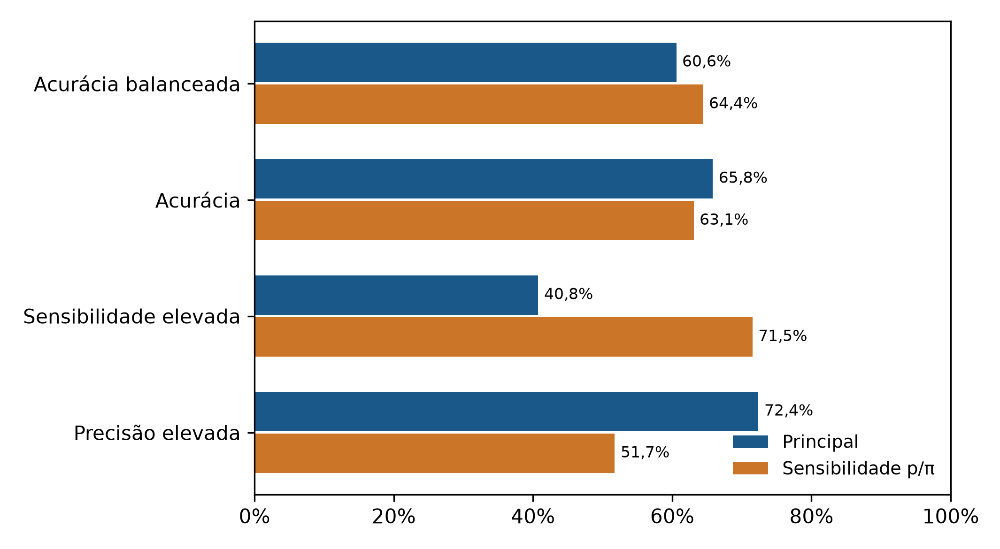
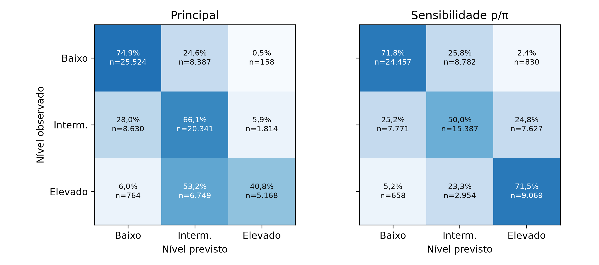

# Sensibilidade da decisão ordinal — conferência de 06/11/2026

## O que mudou

Pesquisador concluiu 36. Foram reproduzidas as métricas originais das 77.535
faixas/21.893 componentes antes de comparar duas regras fixas: argmax p e argmax
p/pi, com pi obtido exclusivamente do respectivo treino externo. Probabilidades,
modelos, hiperparâmetros, observações, pesos, folds e resposta permanecem iguais.
Não houve treino ponderado, recalibração, novo embedding, busca LRCLIB ou
substituição do resultado principal.

36 contém 120 registros de métricas, 1.080 células de confusão e 360 registros
por classe. Agente conferiu resumos/selos, reconciliou as 120 métricas decisórias
com as matrizes e realizou somente a inspeção delimitada da cauda de 128 faixas.
Não repetiu o processamento completo da coorte ou executou modelos.

## Compromisso no Combinado

| Métrica | Principal: argmax p | Sensibilidade: argmax p/pi |
| --- | ---: | ---: |
| Acurácia balanceada | 60,58% | 64,43% |
| Acurácia comum | 65,82% | 63,09% |
| Macro-F1 | 0,6251 | 0,6208 |
| Sensibilidade baixa | 74,92% | 71,79% |
| Sensibilidade intermediária | 66,07% | 49,98% |
| Sensibilidade elevada | 40,75% | 71,52% |
| Precisão elevada | 72,38% | 51,75% |
| Erros extremos baixo↔elevado | 1,19% | 1,92% |

A acurácia balanceada sobe 3,85 pontos, com queda de 2,73 pontos na acurácia comum.
A sensibilidade elevada sobe 30,76 pontos, mas sua precisão cai 20,63 pontos.
Logo, não há melhora em todas as dimensões. A regra muda a importância relativa
dos erros e torna o classificador mais disposto a declarar uma faixa elevada.

São 9.069 elevadas corretamente reconhecidas, antes 5.168: +3.901. Falsas elevadas
passam de 1.972 a 8.457: +6.485. Previsões elevadas totais passam de 7.140 para
17.526. Entre os erros, aumenta especialmente a passagem de intermediária para
elevada, de 1.814 a 7.627. Erros extremos somam 1.488, antes 922. O efeito não
se resume a "acertar mais hits": elevado aqui é o nível operacional 40–100.

## Contribuição das letras nas duas regras

| Bloco | Acurácia balanceada principal | Acurácia balanceada na sensibilidade |
| --- | ---: | ---: |
| Baseline | 59,19% | 63,27% |
| Tradicional | 59,69% | 63,69% |
| Profundo | 60,45% | 64,30% |
| Combinado | 60,58% | 64,43% |

Na regra alternativa, Combinado−Baseline = +1,16 ponto; Combinado−Profundo = +0,13.
O incremento das letras continua modesto. Não atribuir ao texto a melhora de
3,85 pontos causada pela mudança da regra sobre as mesmas probabilidades.
Combinado supera os dois blocos nesses cinco folds na sensibilidade; isso é
descrição, não teste de significância com cinco réplicas independentes.

Pesos amostrais originais somente na avaliação mantêm a ordenação: acurácias
balanceadas alternativas 63,54 / 63,95 / 64,54 / 64,67%. Não constituem correção
de disponibilidade das letras nem autorização de inferência para o catálogo.

## Probabilidade e decisão

Log-loss 0,74505 e Brier 0,45351 do Combinado permanecem idênticos nas duas regras,
pois usam probabilidades e respostas originais. Calibração também não foi
alterada por trocar apenas a classe escolhida. Escores p/pi não são novas
probabilidades calibradas da distribuição observada.

Essa análise foi definida depois de observar o resultado principal. Não houve
busca de limiar/custo no teste, mas a motivação é posterior. Além disso, lambda
e PCA foram selecionados antes para a regra original. O resultado alternativo
é condicional às probabilidades existentes, não CV de uma pipeline integral
selecionada para o novo custo, e não restaura confirmação independente.

## Cauda predefinida ≥80: inspeção delimitada

Amostra lógica de 128 faixas/96 componentes, respostas 80–96, filtrada antes de
materializar. Fonte privada limitada a 16 MiB; sem carregar o quadro completo
de probabilidades em memória pelo agente. Foram inspecionados apenas os campos
de popularidade, componente e probabilidades dessa cauda.

No Combinado, 119/128 (92,97%) recebem nível elevado pela regra principal e 125/128
(97,66%) na sensibilidade; demais nove/três recebem intermediário, nenhuma baixa.
Isso significa classificação como ≥40 entre faixas observadas ≥80. Não é taxa de
detecção binária de hits ≥80: a regra também chama faixas 40–79 de elevadas.
O suporte limitado não permite conclusões amplas sobre hits ou novos artistas.

## Encaminhamento científico

Manter o resultado original como principal e a alternativa como análise de
sensibilidade claramente rotulada. A regra principal favorece maior precisão
entre elevadas declaradas; a alternativa prioriza recuperar mais elevadas com
mais falsos positivos e perda de desempenho intermediário/global. A escolha
de utilidade depende de quais erros o estudo pretende priorizar.

Não iniciar outra rodada de treinos/coleta apenas para tentar elevar métricas.
Próxima entrega é consolidar metodologia/resultados/discussão da monografia,
levando esse compromisso ao orientador, sem ocultar a regressão anterior, o
ganho textual modesto, a seleção rara de PCA, o limite da grade e as restrições
de cobertura, calibração, chances proporcionais e dependência da validação.
Não houve adoção retrospectiva da alternativa como novo procedimento principal.

Fontes de resultados: reports/sensibilidade_decisao_ordinal_200k_v1/ e
reports/analise_sensibilidade_decisao_ordinal_v1/. Protocolo D-027 e primeira
interpretação ordinal preservados. Registro de conferência:
reports/verificacao_sensibilidade_ordinal_20261106.json.
