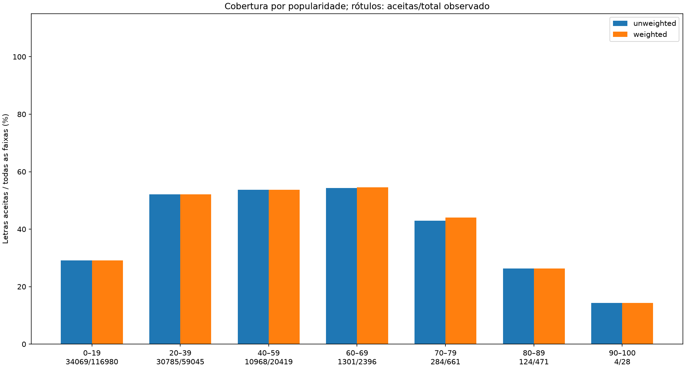
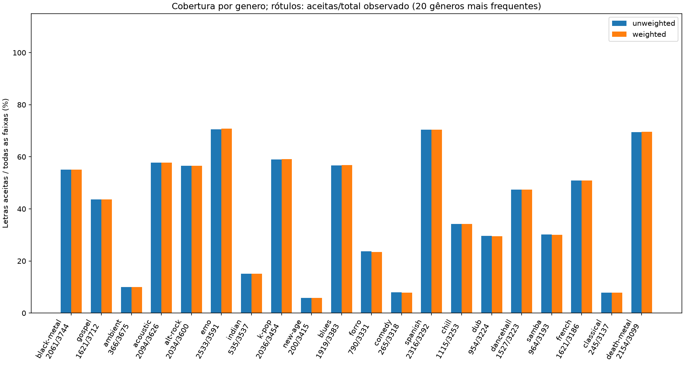
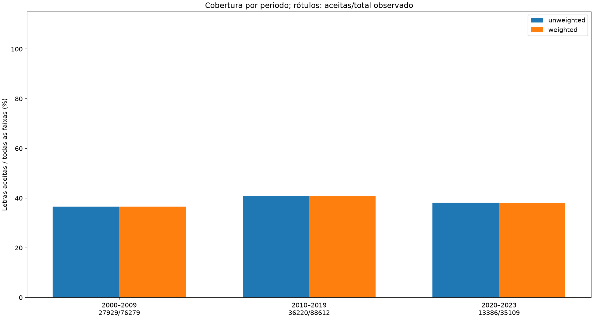

# Recuperação local de letras — rodada v2

Status: **completed**. Novas faixas aceitas: **144**. Aceitas v1 preservadas: 77391; instrumentais v1 preservados: 8748.

## Diagnóstico anterior

| v1_lyrics_status | recovery_initial_diagnostic | n_tracks | sum_weights |
| --- | --- | --- | --- |
| accepted | all_eligible_strict_equivalent | 48783 | 282112.9449 |
| accepted | unique_compatible_plain | 28608 | 166383.3287 |
| ambiguous | different_texts | 19475 | 110363.2383 |
| ambiguous | empty_blocking_text | 10 | 57.5161 |
| ambiguous | instrumental_text_conflict | 248 | 1418.1014 |
| ambiguous | metadata_conflict | 496 | 2888.7588 |
| ambiguous | operational_limit | 841 | 4685.9125 |
| ambiguous | version_conflict | 4705 | 27389.3575 |
| instrumental | compatible_source_instrumental_no_text | 8748 | 50750.5563 |
| insufficient_metadata | missing_artist_or_title | 2 | 11.6809 |
| insufficient_metadata | symbols_erased_by_v1_normalization | 25 | 145.8481 |
| no_text | compatible_without_plain_synced_not_converted | 10 | 58.1139 |
| not_found | artist_present_title_not_found_v1 | 73466 | 428346.9497 |
| not_found | full_credit_not_found_v1 | 14583 | 85151.6928 |

## Transições

| v1_lyrics_status | lyrics_status | n_tracks | sum_weights |
| --- | --- | --- | --- |
| accepted | accepted | 77391 | 448496.2737 |
| ambiguous | accepted | 117 | 680.2635 |
| ambiguous | ambiguous | 25574 | 145636.4185 |
| ambiguous | instrumental | 2 | 11.6783 |
| ambiguous | not_found | 82 | 474.5243 |
| instrumental | instrumental | 8748 | 50750.5563 |
| insufficient_metadata | accepted | 4 | 23.3270 |
| insufficient_metadata | ambiguous | 7 | 40.8147 |
| insufficient_metadata | instrumental | 4 | 23.3346 |
| insufficient_metadata | insufficient_metadata | 2 | 11.6809 |
| insufficient_metadata | not_found | 10 | 58.3718 |
| no_text | ambiguous | 1 | 5.8499 |
| no_text | no_text | 9 | 52.2640 |
| not_found | accepted | 23 | 134.0664 |
| not_found | ambiguous | 1503 | 8738.0239 |
| not_found | instrumental | 5 | 29.1583 |
| not_found | not_found | 86518 | 504597.3939 |

## Recuperações por método exclusivo

| recovery_rule | n_tracks | sum_weights |
| --- | --- | --- |
| cache+contextual_metadata | 110 | 640.1575 |
| cache+contextual_metadata+ignore_empty | 1 | 5.7121 |
| cache+explicit_feat_layout | 1 | 5.8505 |
| cache+explicit_feat_layout+qualifier_layout | 2 | 11.6167 |
| cache+qualifier_layout | 2 | 11.1168 |
| controlled_lookup+explicit_feat_layout | 22 | 128.3278 |
| controlled_lookup+explicit_feat_layout+qualifier_layout | 2 | 11.5485 |
| controlled_lookup+literal_symbols | 4 | 23.3270 |

Cada faixa recuperada pertence a uma combinação de regras; não somar componentes sobrepostos. n_tracks é contagem real; sum_weights usa os pesos congelados.

## Perfil das aceitas antes/depois

| phase | accepted_n | denominator_n | unweighted_rate | accepted_weight | denominator_weight | weighted_rate |
| --- | --- | --- | --- | --- | --- | --- |
| before | 77391 | 200000 | 0.3870 | 448496.2737 | 1159764.0000 | 0.3867 |
| after | 77535 | 200000 | 0.3877 | 449333.9307 | 1159764.0000 | 0.3874 |

| phase | scope | variable | metric | value | denominator |
| --- | --- | --- | --- | --- | --- |
| before | accepted\|unweighted | popularity | mean | 23.9891 | 77391.0000 |
| before | accepted\|unweighted | popularity | q50 | 22.0000 | 77391.0000 |
| before | accepted\|unweighted | duration_ms | mean | 235281.2201 | 77391.0000 |
| before | accepted\|unweighted | duration_ms | q50 | 221653.0000 | 77391.0000 |
| before | accepted\|weighted | popularity | mean | 23.7549 | 448496.2737 |
| before | accepted\|weighted | popularity | q50 | 22.0000 | 448496.2737 |
| before | accepted\|weighted | duration_ms | mean | 235427.6443 | 448496.2737 |
| before | accepted\|weighted | duration_ms | q50 | 221780.0000 | 448496.2737 |
| after | accepted\|unweighted | popularity | mean | 23.9821 | 77535.0000 |
| after | accepted\|unweighted | popularity | q50 | 22.0000 | 77535.0000 |
| after | accepted\|unweighted | duration_ms | mean | 235312.1050 | 77535.0000 |
| after | accepted\|unweighted | duration_ms | q50 | 221669.0000 | 77535.0000 |
| after | accepted\|weighted | popularity | mean | 23.7482 | 449333.9307 |
| after | accepted\|weighted | popularity | q50 | 22.0000 | 449333.9307 |
| after | accepted\|weighted | duration_ms | mean | 235458.4801 | 449333.9307 |
| after | accepted\|weighted | duration_ms | q50 | 221813.0000 | 449333.9307 |

Maiores mudanças de proporção de gênero entre aceitas (até 20 linhas; diferenças em pontos percentuais):

| scope | genre | before_fraction | after_fraction | difference_percentage_points |
| --- | --- | --- | --- | --- |
| accepted\|weighted | hip-hop | 0.0204 | 0.0205 | 0.0053 |
| accepted\|unweighted | hip-hop | 0.0207 | 0.0207 | 0.0052 |
| accepted\|weighted | garage | 0.0190 | 0.0191 | 0.0042 |
| accepted\|unweighted | garage | 0.0190 | 0.0190 | 0.0042 |
| accepted\|weighted | death-metal | 0.0280 | 0.0279 | -0.0039 |
| accepted\|unweighted | death-metal | 0.0278 | 0.0278 | -0.0039 |
| accepted\|weighted | alt-rock | 0.0264 | 0.0263 | -0.0036 |
| accepted\|unweighted | alt-rock | 0.0263 | 0.0262 | -0.0036 |
| accepted\|weighted | spanish | 0.0300 | 0.0300 | 0.0035 |
| accepted\|unweighted | spanish | 0.0298 | 0.0299 | 0.0035 |
| accepted\|weighted | disco | 0.0166 | 0.0166 | -0.0031 |
| accepted\|unweighted | disco | 0.0166 | 0.0166 | -0.0031 |
| accepted\|weighted | punk-rock | 0.0112 | 0.0113 | 0.0031 |
| accepted\|unweighted | punk-rock | 0.0113 | 0.0113 | 0.0031 |
| accepted\|unweighted | ska | 0.0186 | 0.0187 | 0.0030 |
| accepted\|weighted | german | 0.0154 | 0.0154 | -0.0029 |
| accepted\|weighted | ska | 0.0187 | 0.0187 | 0.0029 |
| accepted\|unweighted | german | 0.0154 | 0.0153 | -0.0029 |
| accepted\|weighted | goth | 0.0222 | 0.0222 | -0.0028 |
| accepted\|weighted | electro | 0.0127 | 0.0127 | 0.0028 |

O CSV de comparação inclui amostra completa, aceitas, não aceitas e cada status; gênero, período, ano, popularidade, duração, acústicas, créditos e concentração. Contagens e taxas ponderadas mantêm denominadores explícitos. As 499 faixas ≥80 são destacadas somente nesta análise.

| high_band | v1_lyrics_status | lyrics_status | n_tracks | sum_weights |
| --- | --- | --- | --- | --- |
| 80-89 | accepted | accepted | 124 | 124.0000 |
| 80-89 | ambiguous | ambiguous | 343 | 343.0000 |
| 80-89 | instrumental | instrumental | 2 | 2.0000 |
| 80-89 | not_found | not_found | 2 | 2.0000 |
| 90-100 | accepted | accepted | 4 | 4.0000 |
| 90-100 | ambiguous | ambiguous | 24 | 24.0000 |

## Perdas restantes

| lyrics_status | lyrics_reason | n_tracks | sum_weights |
| --- | --- | --- | --- |
| ambiguous | empty_synced_text | 2 | 11.6837 |
| ambiguous | instrumental_text_conflict | 144 | 834.7028 |
| ambiguous | invalid_or_extended_synced_format | 19 | 110.9299 |
| ambiguous | metadata_conflict | 3319 | 19290.4196 |
| ambiguous | operational_limit:candidate_limit | 846 | 4715.0098 |
| ambiguous | plain_synced_conflict | 13081 | 74666.1377 |
| ambiguous | positive_version_conflict | 8578 | 48414.4198 |
| ambiguous | substantively_distinct_texts | 1081 | 6290.7563 |
| ambiguous | unordered_synced_timestamps | 15 | 87.0472 |
| instrumental | compatible_source_instrumental_no_text | 8759 | 50814.7275 |
| insufficient_metadata | missing_artist_or_title | 2 | 11.6809 |
| no_text | compatible_without_text | 9 | 52.2640 |
| not_found | no_candidate_controlled_keys | 86610 | 505130.2900 |

## Regras e limites

Uma rodada: evidências v1, seguida de uma consulta por par de chaves controladas quando necessária. Participação explícita feat./ft./featuring pode mudar de campo; não dividimos bandas por &, and, vírgula ou ponto e vírgula. Versões têm contexto e qualificadores completos. Duração mantém tolerância de dez segundos. Instrumentalness não participa da aceitação.

Texto vazio deixa de bloquear texto compatível. LRC válido pode fornecer texto derivado; formatos não suportados e conflitos plain/synced permanecem explícitos. Equivalência adicional limita-se a sinais tipográficos, preservando palavras, caixa, versos e repetições. Similaridade não prova identidade.

Aceitações são automáticas. A amostra privada dirigida, até três consultas por método, permanece sem revisão humana. Testes sintéticos não estimam precisão. Homônimos, créditos incompletos e versões insuficientemente descritas continuam limitando identidade; não há aliases nem transliteração.

Limitações v1 foram identificadas no código: normalização pode colapsar sinais/acentos, flags detectavam palavras fora de qualificadores e representações sincronizadas não eram confrontadas. Isso não demonstra erro em uma aceitação específica; as aceitações antigas permanecem com sua regra/origem v1, sem alteração silenciosa.

Marcação instrumental LRCLIB, instrumentalness e qualificador no título são evidências distintas, sem verdade absoluta ou corte de exclusão. Pesos amostrais não corrigem perdas por disponibilidade/aceitação. Nem tamanho do conjunto nem proximidade de distribuições demonstra representatividade. Não há afirmação causal, modelos ou novos splits; a exposição prévia do teste V0.6 permanece.

## Tempos e execução

Tempo desta invocação até o relatório: 2291.16 s. Histórico por fase e retomada no JSON; invocações encerradas à força podem não ter tempo final salvo.

